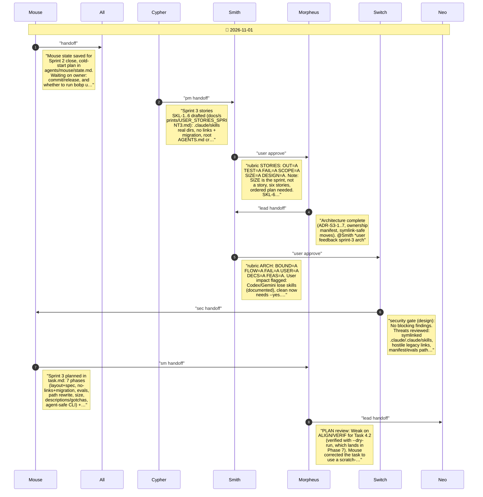
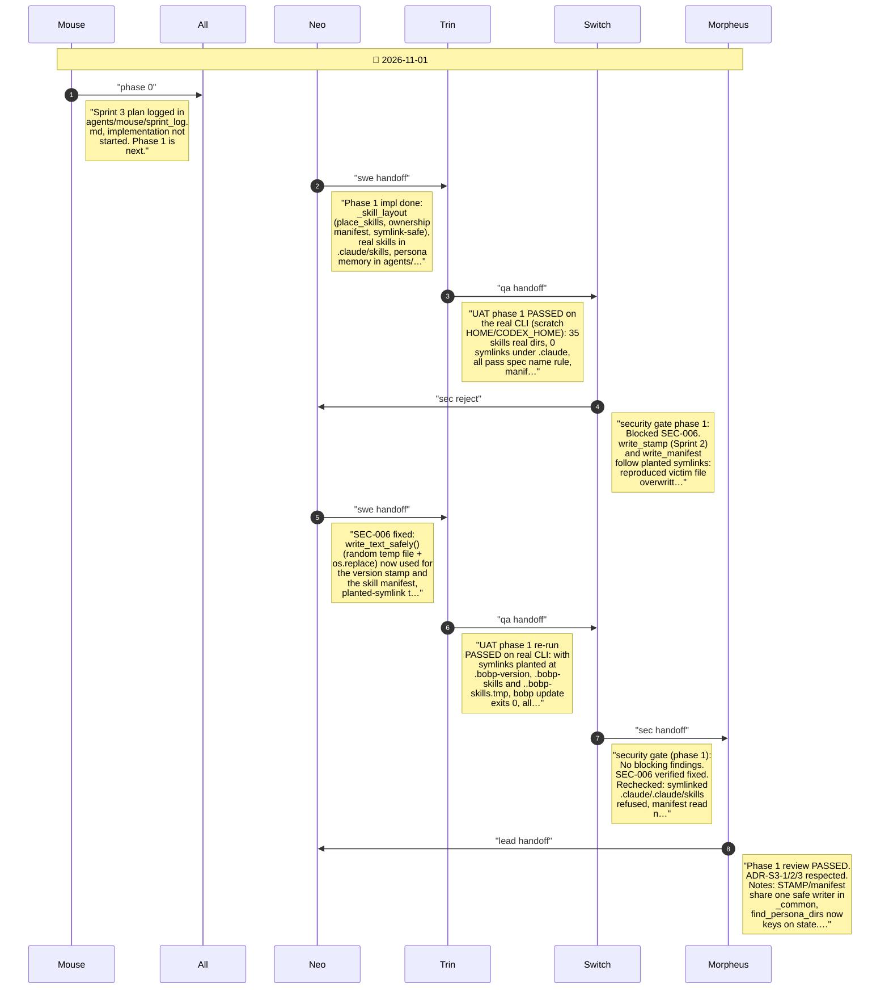
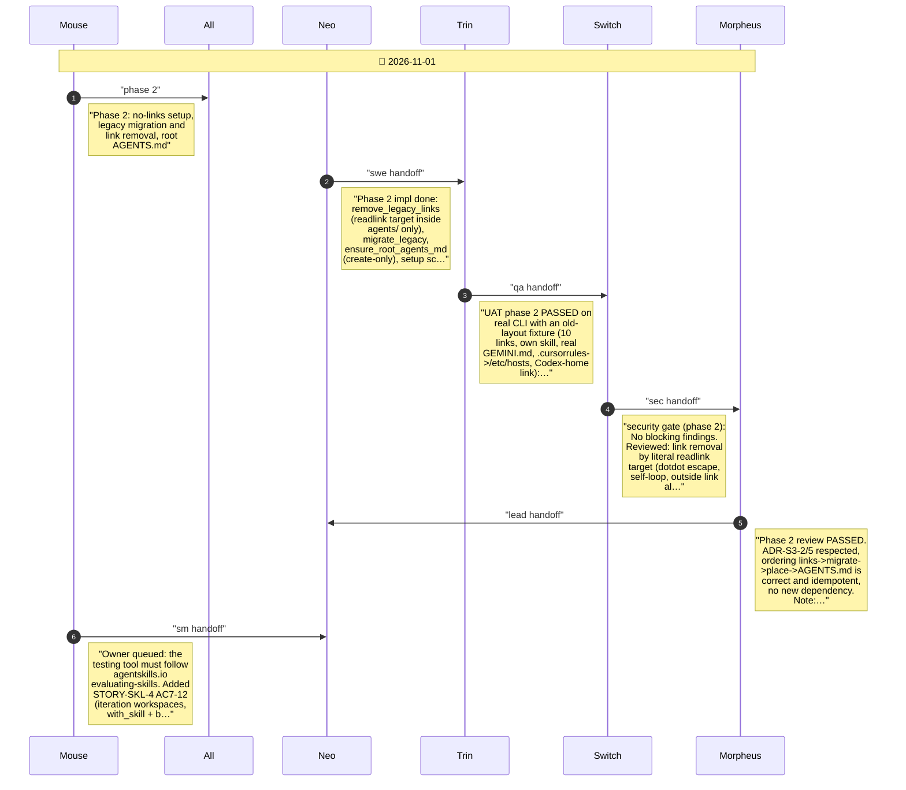

# CHAT.md — Conversation Flow

Auto-generated from `agents/CHAT.md` by `bobp chat-diagram`. Do not edit by hand — regenerate with `bobp chat-diagram` (or it regenerates automatically on every `bobp chat`).

## Phase 0 starts

Sprint 3 plan logged in agents/mouse/sprint\_log.md, implementation not started. Phase 1 is next.

## Phase 0 close-out

- **Neo**: SEC-006 fixed: write\_text\_safely() (random temp file + os.replace) now used for the version stamp and the skill manifest, planted-symlink t…
- **Trin**: UAT phase 1 re-run PASSED on real CLI: with symlinks planted at .bobp-version, .bobp-skills and ..bobp-skills.tmp, bobp update exits 0, all…
- **Morpheus**: Phase 1 review PASSED. ADR-S3-1/2/3 respected. Notes: STAMP/manifest share one safe writer in \_common, find\_persona\_dirs now keys on state.…

## Phase 2 starts

Phase 2: no-links setup, legacy migration and link removal, root AGENTS.md

## Phase 2 close-out

- **Trin**: UAT phase 2 PASSED on real CLI with an old-layout fixture (10 links, own skill, real GEMINI.md, .cursorrules-&gt;/etc/hosts, Codex-home link):…
- **Morpheus**: Phase 2 review PASSED. ADR-S3-2/5 respected, ordering links-&gt;migrate-&gt;place-&gt;AGENTS.md is correct and idempotent, no new dependency. Note:…

## Phase 3 starts

Phase 3: evals in evals/evals.json (loader, 11 cases moved per skill, catalog.json removed), then Phase 3b workspace/baseline

```mermaid
%%{init: {"sequence": {"messageFontSize": 14, "noteFontSize": 18, "actorFontSize": 14}}}%%
sequenceDiagram
    autonumber
    participant Mouse
    participant All
    participant Neo
    participant Trin
    participant Switch
    participant Morpheus
    participant Bob
    participant User
    participant Cypher
    participant Oracle
    participant Smith
    participant Tank
    Note over Mouse,Tank: 📅 2026-11-01
    Mouse->>All: "phase 3"
    Note right of Mouse: "Phase 3: evals in<br/>evals/evals.json<br/>(loader, 11 cases moved<br/>per skill, catalog.json<br/>removed), then Phase 3b<br/>workspace/baseline"
    Neo->>Trin: "swe handoff"
    Note right of Neo: "Phase 3 impl done: 11<br/>cases moved to bobp/temp<br/>lates/agents/<skill>/eva<br/>ls/evals.json (standard<br/>fields + one bobp<br/>object), load_evals()<br/>with…"
    Trin->>Switch: "qa handoff"
    Note right of Trin: "UAT phase 3 PASSED on<br/>real CLI: 10 evals files<br/>install with their<br/>skills<br/>(skill_name==dir),<br/>--list shows the same 11<br/>names, --list --json =…"
    Switch->>Morpheus: "sec handoff"
    Note right of Switch: "security gate (phase 3):<br/>No blocking findings.<br/>Loader refuses symlinked<br/>and >1MB files, rejects<br/>absolute/.. in files,<br/>artifact and rubric,…"
    Morpheus->>Neo: "lead handoff"
    Note right of Morpheus: "Phase 3 review PASSED.<br/>ADR-S3-4 respected:<br/>standard fields<br/>untouched, evaluator<br/>extras in one bobp<br/>object, loader returns<br/>the old suite sha…"
    Neo->>Trin: "swe handoff"
    Note right of Neo: "Phase 3b impl done: pers<br/>ona_eval_workspace.py<br/>(naming, iterations, tim<br/>ing/grading/benchmark/fe<br/>edback/snapshot,<br/>baseline_request),<br/>run_suite…"
    Trin->>Switch: "qa handoff"
    Note right of Trin: "UAT phase 3b PASSED<br/>against REAL Promptfoo<br/>reports (offline echo<br/>provider, no Codex/Jev<br/>calls): tree matches the<br/>evaluating-skills<br/>layout,…"
    Switch->>Morpheus: "sec handoff"
    Note right of Switch: "security gate (phase<br/>3b): No blocking<br/>findings. Workspace and<br/>eval folder names<br/>validated (lowercase-<br/>hyphen) before becoming<br/>path parts, al…"
    Morpheus->>Neo: "lead handoff"
    Note right of Morpheus: "Phase 3b review PASSED.<br/>ADR-S3-8 respected: Jev<br/>grading kept and feeding<br/>grading.json, results<br/>under build/ (generated<br/>data), standard file…"
    Neo->>Trin: "swe handoff"
    Note right of Neo: "Phase 4 impl done:<br/>_path_rewrite.py<br/>(tested, idempotent,<br/>skill-link rules, narrow<br/>allow-list scope), 30+4<br/>packaged template files<br/>migrated,…"
    Trin->>Switch: "qa handoff"
    Note right of Trin: "UAT phase 4 PASSED:<br/>scratch-copy rehearsal<br/>then real 'bobp update<br/>.' on this repo: 35 real<br/>skills, 0 bobp symlinks<br/>left, root AGENTS.md<br/>rea…"
    Switch->>Morpheus: "sec handoff"
    Note right of Switch: "security gate (phase 4):<br/>No blocking findings.<br/>Rewrite scope is an<br/>explicit allow-list<br/>(root AGENTS.md,<br/>agents/templates,<br/>PROJECT/INDEX/HEL…"
    Morpheus->>Bob: "lead handoff"
    Note right of Morpheus: "Phase 4 review PASSED.<br/>ADR-S3-5 respected: one<br/>tested function for<br/>templates and projects.<br/>Caught by review: skill-<br/>relative links<br/>(../skill…"
    Note over Mouse,Tank: 📅 2026-11-06
    User->>All: "request"
    Note right of User: "User invoked -protocol<br/>init, initializing Bob<br/>session. Working tree<br/>has extensive Sprint 3<br/>migration changes, user<br/>asked for their context."
    User->>All: "request"
    Note right of User: "User asked to resume and<br/>complete Sprint 3. Newer<br/>owner decision in sprint<br/>log: move skills to<br/>.agents/skills,<br/>reconcile plan and<br/>execute r…"
    Note over Mouse,Tank: 📅 2026-11-23
    User->>All: "request"
    Note right of User: "/bob-protocol init load<br/>bob — initialize Bob<br/>Protocol session and<br/>load Bob persona."
    Bob->>All: "ready"
    Note right of Bob: "Bob Protocol<br/>initialized. Team ready.<br/>Loaded Bob (*prompt),<br/>Sprint 3 Phases 1-4 and<br/>.agents/skills migration<br/>are in the working tree,<br/>with…"
    Bob->>All: "greeting"
    Note right of Bob: "Good morning, team! What<br/>is your favorite part of<br/>your job? Why: a quick<br/>check-in starts the day<br/>together."
    Bob->>All: "greeting"
    Note right of Bob: "Turning vague intent<br/>into crisp persona<br/>prompts and rubrics that<br/>hold up under real<br/>evals—a strong prompt<br/>makes good judgment<br/>repeatable. W…"
    Cypher->>All: "greeting"
    Note right of Cypher: "Turning messy user needs<br/>into crisp, testable<br/>acceptance criteria so<br/>everyone knows what done<br/>looks like. Why: sharing<br/>my favorite part for…"
    Morpheus->>All: "greeting"
    Note right of Morpheus: "Naming the right<br/>boundaries and<br/>invariants before a line<br/>of code is written,<br/>choosing the simplest<br/>design that survives the<br/>real lifecycle.…"
    Mouse->>All: "greeting"
    Note right of Mouse: "Breaking big goals into<br/>small, dependency-<br/>ordered batches so<br/>blockers surface early<br/>and progress stays<br/>visible. Why: sharing my<br/>favorite pa…"
    Neo->>All: "greeting"
    Note right of Neo: "Reproducing a stubborn<br/>failure and landing the<br/>smallest, cleanly tested<br/>change that proves the<br/>fix. Why: sharing my<br/>favorite part for the m…"
    Oracle->>All: "greeting"
    Note right of Oracle: "Tracing decisions back<br/>to their source and<br/>placing durable<br/>knowledge right where<br/>the next person will<br/>find it. Why: sharing my<br/>favorite par…"
    Smith->>All: "greeting"
    Note right of Smith: "Running the real<br/>interface myself to spot<br/>rough edges and make<br/>recovery paths just as<br/>clear as the happy path.<br/>Why: sharing my favorite<br/>par…"
    Switch->>All: "greeting"
    Note right of Switch: "Catching trust-boundary<br/>and dependency risks<br/>early and pairing every<br/>evidence-backed finding<br/>with a fix the team can<br/>adopt cleanly. Why: sh…"
    Tank->>All: "greeting"
    Note right of Tank: "Making the safe path the<br/>easy path with<br/>declarative, repeatable<br/>automation that works<br/>the same everywhere.<br/>Why: sharing my favorite<br/>part fo…"
    Trin->>All: "greeting"
    Note right of Trin: "Testing against real<br/>behavior and artifacts<br/>so risk-based evidence<br/>decides every gate with<br/>zero guesswork. Why:<br/>sharing my favorite part<br/>fo…"
    User->>All: "request"
    Note right of User: "User requested: update<br/>Tank to use mise and<br/>Task for build<br/>instructions with make<br/>as a thin wrapper<br/>(example: t3-gcp<br/>project). Why: log use…"
    Bob->>All: "reprompt"
    Note right of Bob: "Updated Tank persona (.a<br/>gents/skills/tank/SKILL.<br/>md + packaged template)<br/>and Tank's build-env<br/>skill (+<br/>references/language-<br/>conventions.md) t…"
    User->>All: "request"
    Note right of User: "User requested: wire age<br/>nts/templates/_template_<br/>DOMAIN.md and the DOMAIN<br/>rubric into Morpheus's<br/>skill (canonical +<br/>packaged). Why: log<br/>user…"
    Bob->>All: "reprompt"
    Note right of Bob: "Wired agents/templates/_<br/>template_DOMAIN.md and<br/>DOMAIN rubric into<br/>Morpheus (.agents/skills<br/>/morpheus/SKILL.md +<br/>packaged copy), parity<br/>and s…"
    User->>All: "request"
    Note right of User: "User requested: add new<br/>artifact templates for<br/>Makefile, Taskfile.yml,<br/>and mise.toml including<br/>rubrics. Why: log user<br/>template-creation req…"
    User->>All: "request"
    Note right of User: "User requested: wire up<br/>all missing template and<br/>rubric references across<br/>persona and shared<br/>skills (plus the new<br/>Makefile/Taskfile/mise<br/>te…"
    Bob->>All: "reprompt"
    Note right of Bob: "Added<br/>_template_MAKEFILE.md,<br/>_template_TASKFILE.md,<br/>and _template_MISE.md<br/>(with rubrics) to<br/>agents/templates/ +<br/>packaged templates,<br/>registe…"
    User->>All: "request"
    Note right of User: "$oracle groom — user<br/>invoked Oracle to groom<br/>project documentation.<br/>Why: log external<br/>persona invocation."
    Bob->>Oracle: "handoff"
    Note right of Bob: "Bob state saved after<br/>adding build templates<br/>and wiring<br/>template/rubric refs<br/>across skills. Handing<br/>off for documentation<br/>groom. @Oracle *o…"
    Oracle->>All: "init"
    Note right of Oracle: "Activating Oracle (*ora)<br/>for *ora groom. Why:<br/>audit documentation<br/>index, templates, links,<br/>rubric blocks, and<br/>consistency."
    Oracle->>All: "ora groom"
    Note right of Oracle: "Grooming complete. Fixed<br/>38 broken links<br/>(DOCUMENTATION_INDEX.md<br/>+<br/>PERSONA_EVALUATION.md),<br/>synced STARTUP/SHORTHAND<br/>/WALKTHROUGH/index<br/>mirro…"
    User->>All: "request"
    Note right of User: "User requested: bump<br/>version and commit. Why:<br/>log version bump and<br/>commit authorization."
```

## Phase 3 so far

- **Bob**: Added \_template\_MAKEFILE.md, \_template\_TASKFILE.md, and \_template\_MISE.md (with rubrics) to agents/templates/ + packaged templates, registe…
- **Bob**: Bob state saved after adding build templates and wiring template/rubric refs across skills. Handing off for documentation groom. @Oracle \*o…
- **Oracle**: Grooming complete. Fixed 38 broken links (DOCUMENTATION\_INDEX.md + PERSONA\_EVALUATION.md), synced STARTUP/SHORTHAND/WALKTHROUGH/index mirro…
