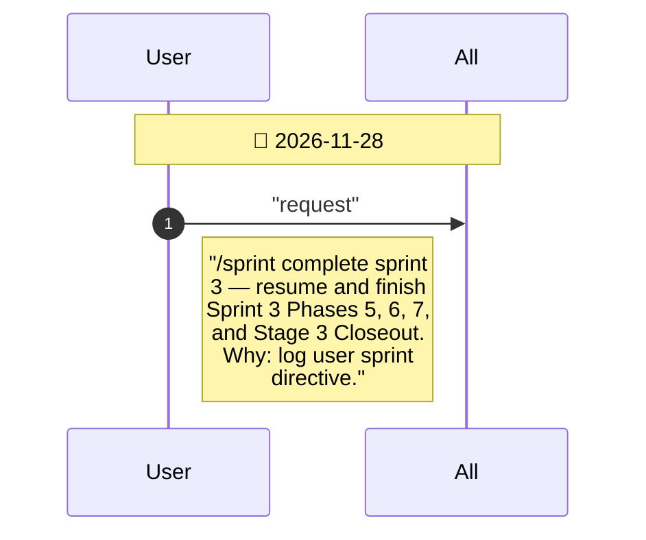
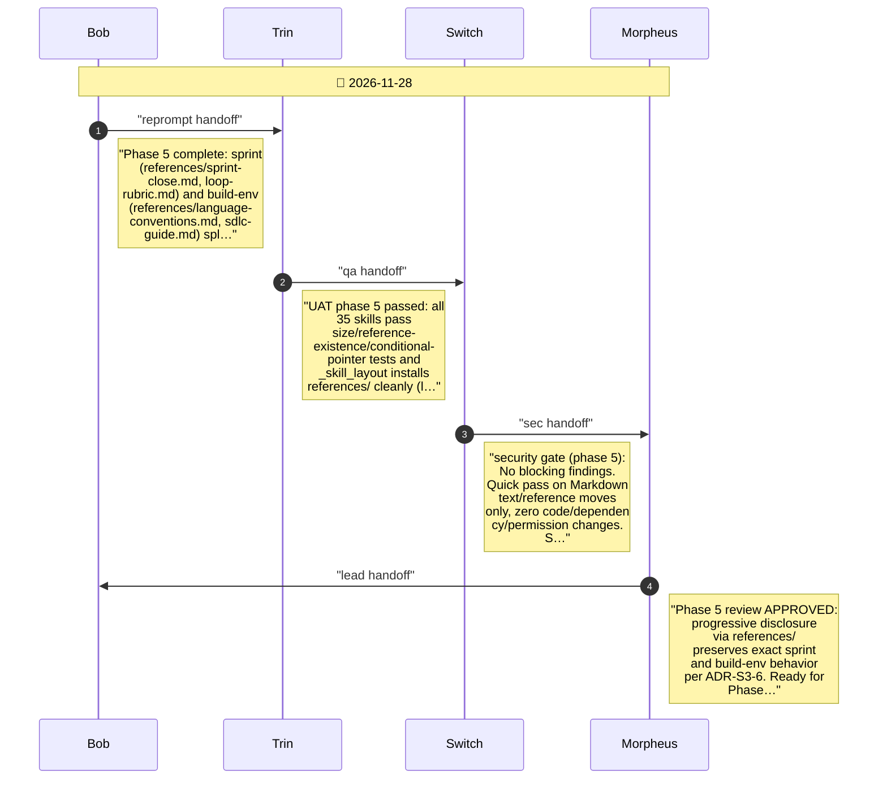
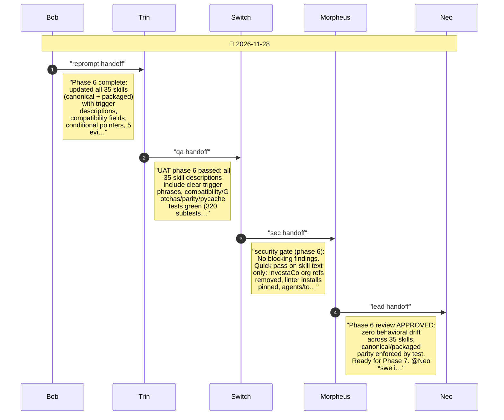
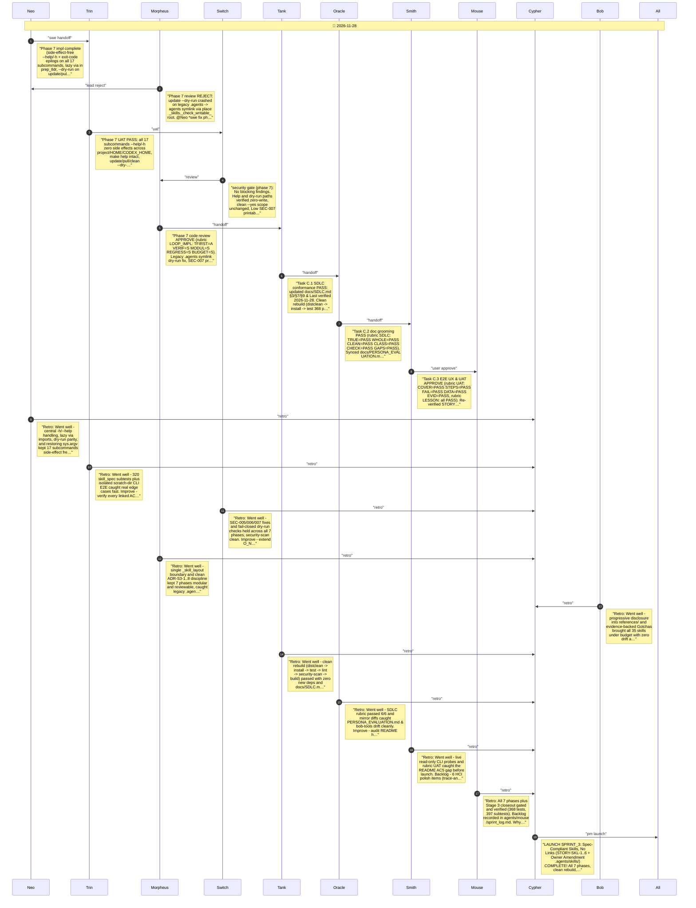

# CHAT_SPRINT_3 — Sprint Archive

## Summary

Sprint 3 (Spec-Compliant Skills, No Links) delivered real .agents/skills/ directories with zero symlinks, root AGENTS.md, legacy migration, per-skill evals/evals.json and evaluating-skills workspaces, Agent Skills best-practices compliance across all 35 skills (size limits, references/, trigger descriptions, Gotchas, compatibility), and agent-safe CLI (--help, --dry-run, clean --yes, exit codes). All 7 phases and Stage 3 closeout passed (368 tests, 397 subtests, clean rebuild, security-scan, Mermaid lint, Smith UX APPROVE).

---

## Planning

---

## Phase 5

Restored Sprint 3 task board to task.md (Sprint 4 archived at docs/sprints/TASK_SPRINT4.md). Starting Phase 5 (Bob: size limits, references/, enforcing tests). @Bob *reprompt phase-5. Why: resume Sprint 3.

---

## Phase 6

Phase 6: Descriptions with trigger phrases, ## Gotchas from real lessons/findings, conditional pointers, compatibility fields, generalize render, pin linter, remove agents/tools/__pycache__. Why: phase start marker for Sprint 3.

---

## Phase 7

Phase 7: Agent-safe subcommands (--help side-effect free on all subcommands, --dry-run on update/pull/clean, --yes required on clean exiting 2, exit-code epilogs). Why: phase start marker for Sprint 3.

## Sprint close-out

- **Cypher**: LAUNCH SPRINT\_3: Spec-Compliant Skills, No Links (STORY-SKL-1..6 + Owner Amendment .agents/skills/) COMPLETE\! All 7 phases, clean rebuild,…
