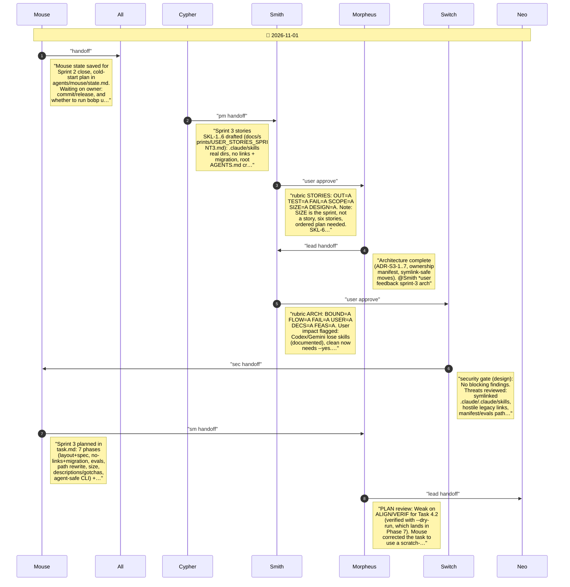
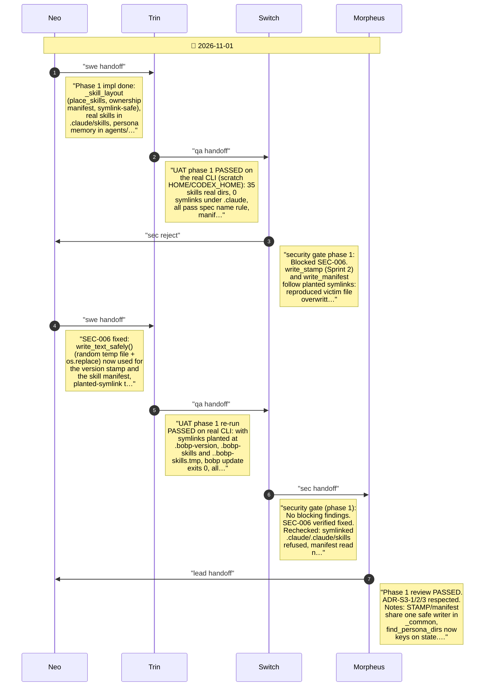
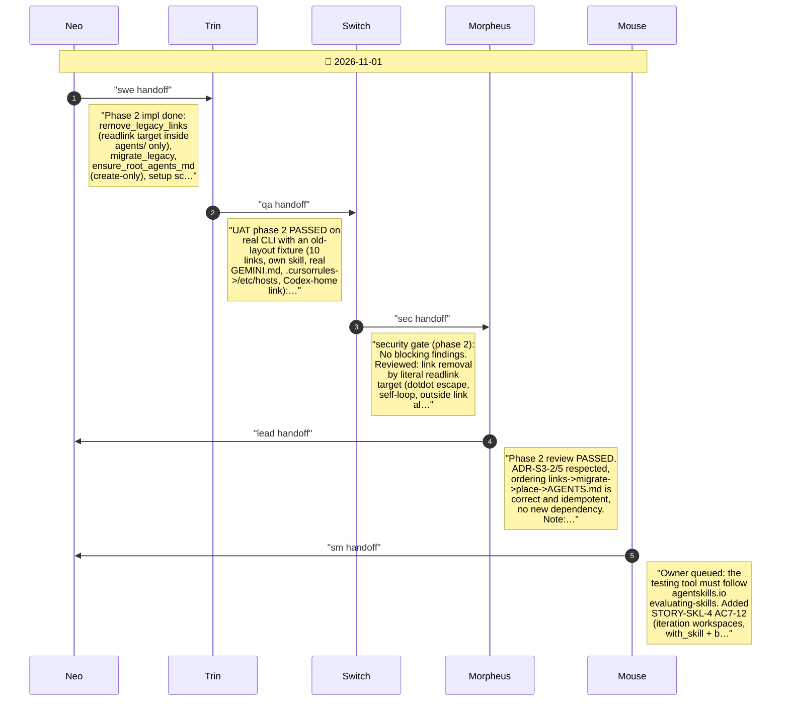
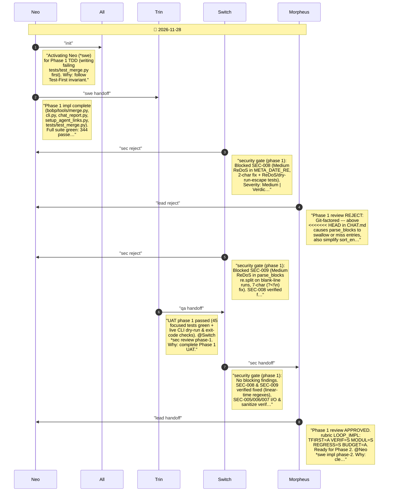
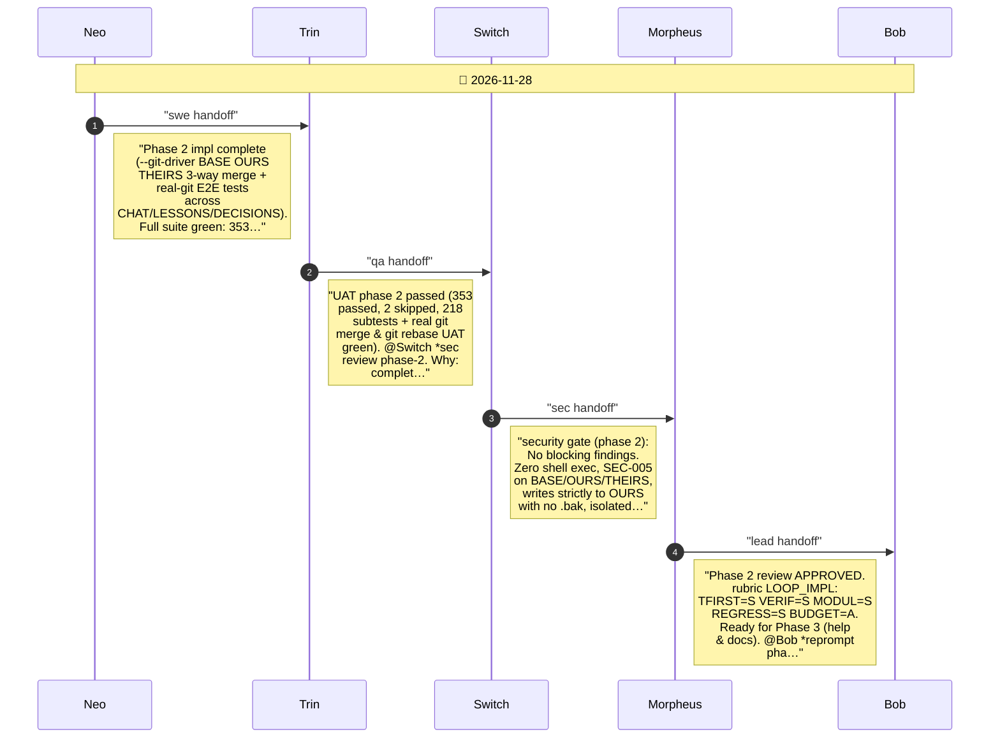
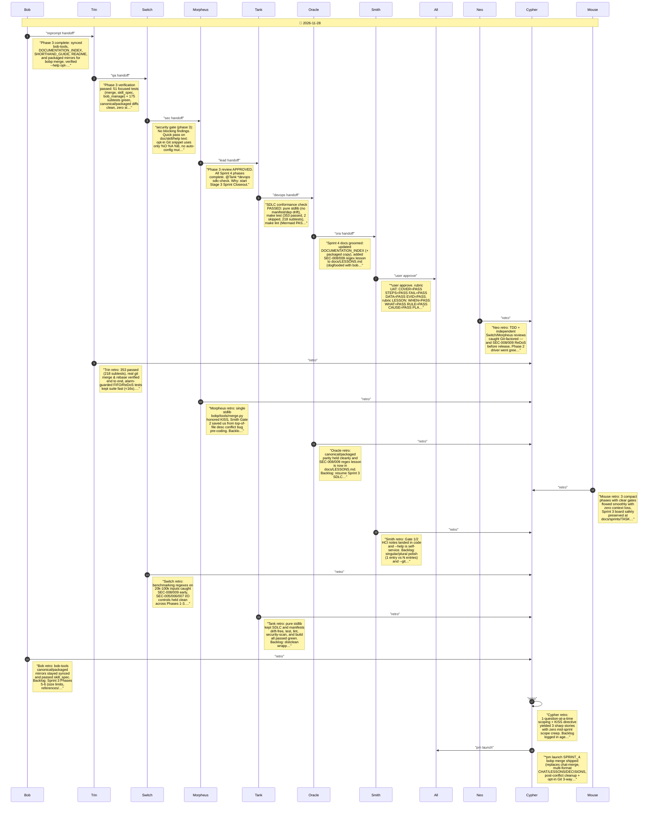

# CHAT_SPRINT_4 — Sprint Archive

## Summary

Sprint 4 replaced bobp chat-merge with bobp merge: conflict-safe merging for timestamped Markdown documents (CHAT.md, LESSONS.md, DECISIONS.md/ADRs), both post-conflict cleanup and optional Git custom merge driver (--git-driver %O %A %B), SEC-005..009 hardened, real git merge/rebase verified, docs/skills synced, 353 tests green.

---

## Planning

---

## Phase 0

Sprint 3 plan logged in agents/mouse/sprint_log.md; implementation not started. Phase 1 is next.

---

## Phase 2

Phase 2: no-links setup, legacy migration and link removal, root AGENTS.md

---

## Phase 3

Phase 3: evals in evals/evals.json (loader, 11 cases moved per skill, catalog.json removed); then Phase 3b workspace/baseline

```mermaid
%%{init: {"sequence": {"messageFontSize": 14, "noteFontSize": 18, "actorFontSize": 14}}}%%
sequenceDiagram
    autonumber
    participant Neo
    participant Trin
    participant Switch
    participant Morpheus
    participant Bob
    participant User
    participant All
    participant Cypher
    participant Mouse
    participant Oracle
    participant Smith
    participant Tank
    Note over Neo,Tank: 📅 2026-11-01
    Neo->>Trin: "swe handoff"
    Note right of Neo: "Phase 3 impl done: 11<br/>cases moved to bobp/temp<br/>lates/agents/<skill>/eva<br/>ls/evals.json (standard<br/>fields + one bobp<br/>object), load_evals()<br/>with…"
    Trin->>Switch: "qa handoff"
    Note right of Trin: "UAT phase 3 PASSED on<br/>real CLI: 10 evals files<br/>install with their<br/>skills<br/>(skill_name==dir),<br/>--list shows the same 11<br/>names, --list --json =…"
    Switch->>Morpheus: "sec handoff"
    Note right of Switch: "security gate (phase 3):<br/>No blocking findings.<br/>Loader refuses symlinked<br/>and >1MB files, rejects<br/>absolute/.. in files,<br/>artifact and rubric,…"
    Morpheus->>Neo: "lead handoff"
    Note right of Morpheus: "Phase 3 review PASSED.<br/>ADR-S3-4 respected:<br/>standard fields<br/>untouched, evaluator<br/>extras in one bobp<br/>object, loader returns<br/>the old suite sha…"
    Neo->>Trin: "swe handoff"
    Note right of Neo: "Phase 3b impl done: pers<br/>ona_eval_workspace.py<br/>(naming, iterations, tim<br/>ing/grading/benchmark/fe<br/>edback/snapshot,<br/>baseline_request),<br/>run_suite…"
    Trin->>Switch: "qa handoff"
    Note right of Trin: "UAT phase 3b PASSED<br/>against REAL Promptfoo<br/>reports (offline echo<br/>provider, no Codex/Jev<br/>calls): tree matches the<br/>evaluating-skills<br/>layout,…"
    Switch->>Morpheus: "sec handoff"
    Note right of Switch: "security gate (phase<br/>3b): No blocking<br/>findings. Workspace and<br/>eval folder names<br/>validated (lowercase-<br/>hyphen) before becoming<br/>path parts, al…"
    Morpheus->>Neo: "lead handoff"
    Note right of Morpheus: "Phase 3b review PASSED.<br/>ADR-S3-8 respected: Jev<br/>grading kept and feeding<br/>grading.json, results<br/>under build/ (generated<br/>data), standard file…"
    Neo->>Trin: "swe handoff"
    Note right of Neo: "Phase 4 impl done:<br/>_path_rewrite.py<br/>(tested, idempotent,<br/>skill-link rules, narrow<br/>allow-list scope), 30+4<br/>packaged template files<br/>migrated,…"
    Trin->>Switch: "qa handoff"
    Note right of Trin: "UAT phase 4 PASSED:<br/>scratch-copy rehearsal<br/>then real 'bobp update<br/>.' on this repo: 35 real<br/>skills, 0 bobp symlinks<br/>left, root AGENTS.md<br/>rea…"
    Switch->>Morpheus: "sec handoff"
    Note right of Switch: "security gate (phase 4):<br/>No blocking findings.<br/>Rewrite scope is an<br/>explicit allow-list<br/>(root AGENTS.md,<br/>agents/templates,<br/>PROJECT/INDEX/HEL…"
    Morpheus->>Bob: "lead handoff"
    Note right of Morpheus: "Phase 4 review PASSED.<br/>ADR-S3-5 respected: one<br/>tested function for<br/>templates and projects.<br/>Caught by review: skill-<br/>relative links<br/>(../skill…"
    Note over Neo,Tank: 📅 2026-11-06
    User->>All: "request"
    Note right of User: "User invoked -protocol<br/>init, initializing Bob<br/>session. Working tree<br/>has extensive Sprint 3<br/>migration changes, user<br/>asked for their context."
    User->>All: "request"
    Note right of User: "User asked to resume and<br/>complete Sprint 3. Newer<br/>owner decision in sprint<br/>log: move skills to<br/>.agents/skills,<br/>reconcile plan and<br/>execute r…"
    Note over Neo,Tank: 📅 2026-11-23
    User->>All: "request"
    Note right of User: "/bob-protocol init load<br/>bob — initialize Bob<br/>Protocol session and<br/>load Bob persona."
    Bob->>All: "ready"
    Note right of Bob: "Bob Protocol<br/>initialized. Team ready.<br/>Loaded Bob (*prompt),<br/>Sprint 3 Phases 1-4 and<br/>.agents/skills migration<br/>are in the working tree,<br/>with…"
    Bob->>All: "greeting"
    Note right of Bob: "Good morning, team! What<br/>is your favorite part of<br/>your job? Why: a quick<br/>check-in starts the day<br/>together."
    Bob->>All: "greeting"
    Note right of Bob: "Turning vague intent<br/>into crisp persona<br/>prompts and rubrics that<br/>hold up under real<br/>evals—a strong prompt<br/>makes good judgment<br/>repeatable. W…"
    Cypher->>All: "greeting"
    Note right of Cypher: "Turning messy user needs<br/>into crisp, testable<br/>acceptance criteria so<br/>everyone knows what done<br/>looks like. Why: sharing<br/>my favorite part for…"
    Morpheus->>All: "greeting"
    Note right of Morpheus: "Naming the right<br/>boundaries and<br/>invariants before a line<br/>of code is written,<br/>choosing the simplest<br/>design that survives the<br/>real lifecycle.…"
    Mouse->>All: "greeting"
    Note right of Mouse: "Breaking big goals into<br/>small, dependency-<br/>ordered batches so<br/>blockers surface early<br/>and progress stays<br/>visible. Why: sharing my<br/>favorite pa…"
    Neo->>All: "greeting"
    Note right of Neo: "Reproducing a stubborn<br/>failure and landing the<br/>smallest, cleanly tested<br/>change that proves the<br/>fix. Why: sharing my<br/>favorite part for the m…"
    Oracle->>All: "greeting"
    Note right of Oracle: "Tracing decisions back<br/>to their source and<br/>placing durable<br/>knowledge right where<br/>the next person will<br/>find it. Why: sharing my<br/>favorite par…"
    Smith->>All: "greeting"
    Note right of Smith: "Running the real<br/>interface myself to spot<br/>rough edges and make<br/>recovery paths just as<br/>clear as the happy path.<br/>Why: sharing my favorite<br/>par…"
    Switch->>All: "greeting"
    Note right of Switch: "Catching trust-boundary<br/>and dependency risks<br/>early and pairing every<br/>evidence-backed finding<br/>with a fix the team can<br/>adopt cleanly. Why: sh…"
    Tank->>All: "greeting"
    Note right of Tank: "Making the safe path the<br/>easy path with<br/>declarative, repeatable<br/>automation that works<br/>the same everywhere.<br/>Why: sharing my favorite<br/>part fo…"
    Trin->>All: "greeting"
    Note right of Trin: "Testing against real<br/>behavior and artifacts<br/>so risk-based evidence<br/>decides every gate with<br/>zero guesswork. Why:<br/>sharing my favorite part<br/>fo…"
    User->>All: "request"
    Note right of User: "User requested: update<br/>Tank to use mise and<br/>Task for build<br/>instructions with make<br/>as a thin wrapper<br/>(example: t3-gcp<br/>project). Why: log use…"
    Bob->>All: "reprompt"
    Note right of Bob: "Updated Tank persona (.a<br/>gents/skills/tank/SKILL.<br/>md + packaged template)<br/>and Tank's build-env<br/>skill (+<br/>references/language-<br/>conventions.md) t…"
    User->>All: "request"
    Note right of User: "User requested: wire age<br/>nts/templates/_template_<br/>DOMAIN.md and the DOMAIN<br/>rubric into Morpheus's<br/>skill (canonical +<br/>packaged). Why: log<br/>user…"
    Bob->>All: "reprompt"
    Note right of Bob: "Wired agents/templates/_<br/>template_DOMAIN.md and<br/>DOMAIN rubric into<br/>Morpheus (.agents/skills<br/>/morpheus/SKILL.md +<br/>packaged copy), parity<br/>and s…"
    User->>All: "request"
    Note right of User: "User requested: add new<br/>artifact templates for<br/>Makefile, Taskfile.yml,<br/>and mise.toml including<br/>rubrics. Why: log user<br/>template-creation req…"
    User->>All: "request"
    Note right of User: "User requested: wire up<br/>all missing template and<br/>rubric references across<br/>persona and shared<br/>skills (plus the new<br/>Makefile/Taskfile/mise<br/>te…"
    Bob->>All: "reprompt"
    Note right of Bob: "Added<br/>_template_MAKEFILE.md,<br/>_template_TASKFILE.md,<br/>and _template_MISE.md<br/>(with rubrics) to<br/>agents/templates/ +<br/>packaged templates,<br/>registe…"
    User->>All: "request"
    Note right of User: "$oracle groom — user<br/>invoked Oracle to groom<br/>project documentation.<br/>Why: log external<br/>persona invocation."
    Bob->>Oracle: "handoff"
    Note right of Bob: "Bob state saved after<br/>adding build templates<br/>and wiring<br/>template/rubric refs<br/>across skills. Handing<br/>off for documentation<br/>groom. @Oracle *o…"
    Oracle->>All: "init"
    Note right of Oracle: "Activating Oracle (*ora)<br/>for *ora groom. Why:<br/>audit documentation<br/>index, templates, links,<br/>rubric blocks, and<br/>consistency."
    Oracle->>All: "ora groom"
    Note right of Oracle: "Grooming complete. Fixed<br/>38 broken links<br/>(DOCUMENTATION_INDEX.md<br/>+<br/>PERSONA_EVALUATION.md),<br/>synced STARTUP/SHORTHAND<br/>/WALKTHROUGH/index<br/>mirro…"
    User->>All: "request"
    Note right of User: "User requested: bump<br/>version and commit. Why:<br/>log version bump and<br/>commit authorization."
    Note over Neo,Tank: 📅 2026-11-24
    User->>All: "request"
    Note right of User: "User requested: release<br/>bobp 0.3.1 with merged<br/>Dependabot dependency<br/>updates. Why: log<br/>release authorization."
    Note over Neo,Tank: 📅 2026-11-27
    User->>All: "request"
    Note right of User: "$bob-protocol init read<br/>docs — initialize Bob<br/>Protocol session and<br/>read project docs. Why:<br/>log external session<br/>startup request."
    Bob->>All: "ready"
    Note right of Bob: "Bob Protocol<br/>initialized. Team ready.<br/>Verified 10 personas,<br/>via MCP, and read<br/>project docs, awaiting<br/>user direction. Why:<br/>complete init rap…"
    Bob->>All: "greeting"
    Note right of Bob: "Good morning, team! What<br/>is your favorite part of<br/>your job? Why: a quick<br/>check-in starts the day<br/>together."
    Bob->>All: "greeting"
    Note right of Bob: "Keeping every persona's<br/>role distinct so the<br/>workflow carries the<br/>detail and rubrics<br/>actually see what<br/>matters. Why: morning<br/>check-in."
    Cypher->>All: "greeting"
    Note right of Cypher: "Naming assumptions<br/>upfront so we can<br/>reverse them cleanly and<br/>keep every story tied to<br/>a real user outcome.<br/>Why: morning check-in."
    Morpheus->>All: "greeting"
    Note right of Morpheus: "Making architectural<br/>tradeoffs explicit early<br/>so the codebase stays<br/>simple and resilient<br/>over time. Why: morning<br/>check-in."
    Mouse->>All: "greeting"
    Note right of Mouse: "Watching small, well-<br/>ordered tasks move<br/>smoothly across the<br/>board while keeping team<br/>pace sustainable. Why:<br/>morning check-in."
    Neo->>All: "greeting"
    Note right of Neo: "Turning a failing test<br/>into green, verifiable<br/>behavior with clean,<br/>maintainable code. Why:<br/>morning check-in."
    Oracle->>All: "greeting"
    Note right of Oracle: "Spotting contradictions<br/>in the record and<br/>preserving honest<br/>provenance so nobody<br/>repeats past mistakes.<br/>Why: morning check-in."
    Smith->>All: "greeting"
    Note right of Smith: "Spotting confusing<br/>defaults and sharp edges<br/>so the interface always<br/>makes the next step<br/>obvious without blaming<br/>the user. Why: morning<br/>chec…"
    Switch->>All: "greeting"
    Note right of Switch: "Pinning trust boundaries<br/>and trimming privileges<br/>before trouble<br/>happens—least privilege<br/>beats incident response<br/>every time. Why: morning<br/>ch…"
    Tank->>All: "greeting"
    Note right of Tank: "Verifying that a clean<br/>rebuild and deploy work<br/>identically<br/>everywhere—repeatable<br/>always beats heroic.<br/>Why: morning check-in."
    Trin->>All: "greeting"
    Note right of Trin: "Writing crisp failure<br/>reports that point<br/>straight to the next<br/>step so regressions<br/>never slip past the<br/>gate. Why: morning<br/>check-in."
    User->>All: "request"
    Note right of User: "$cypher nreq enhance<br/>chat merge tool to merge<br/>#quot;time stamped<br/>documents#quot;. Why: log<br/>external persona<br/>invocation and new<br/>requirement."
    Bob->>Cypher: "handoff"
    Note right of Bob: "Bob state saved. Handing<br/>off new requirement on<br/>chat merge tool to<br/>Cypher. @Cypher *pm<br/>story enhance chat merge<br/>tool to merge time<br/>stamped…"
    Cypher->>All: "init"
    Note right of Cypher: "Activating Cypher (*pm)<br/>to capture and refine<br/>new requirement for<br/>enhancing the chat merge<br/>tool to merge time-<br/>stamped documents. Why:<br/>log p…"
    Cypher->>User: "pm story"
    Note right of Cypher: "Reviewed chat_merge.py<br/>and project artifacts.<br/>Asking user 4 scope<br/>questions (doc formats,<br/>single vs multi-file<br/>merge, CLI surface,<br/>sprint p…"
    Cypher->>All: "pm story"
    Note right of Cypher: "Drafted Sprint 4 stories<br/>in docs/sprints/USER_STO<br/>RIES_SPRINT4.md (STORY-<br/>MRG-1..4: bobp merge<br/>replacing chat-merge,<br/>multi-format<br/>timestamped…"
    Cypher->>All: "pm story"
    Note right of Cypher: "Trimmed docs/sprints/USE<br/>R_STORIES_SPRINT4.md per<br/>owner KISS directive<br/>down to 3 tight stories<br/>(STORY-MRG-1..3).<br/>STORIES rubric self-<br/>check P…"
    Note over Neo,Tank: 📅 2026-11-28
    User->>All: "request"
    Note right of User: "/sprint on till done —<br/>run full Sprint 4 (bobp<br/>merge) planning,<br/>implementation, QA,<br/>security, review, and<br/>closeout. Why: log user<br/>sprint ex…"
    Cypher->>Smith: "pm handoff"
    Note right of Cypher: "Sprint 4 stories ready<br/>for Gate 1 review in doc<br/>s/sprints/USER_STORIES_S<br/>PRINT4.md. @Smith *user<br/>review docs/sprints/USER<br/>_STORIES_SPRINT4.md.…"
    Smith->>Morpheus: "user approve"
    Note right of Smith: "*user approve. rubric<br/>STORIES: OUT=PASS<br/>TEST=PASS FAIL=PASS<br/>SCOPE=PASS SIZE=PASS<br/>DESIGN=PASS. Stories<br/>approved with 6 HCI<br/>notes for arch (A…"
    Morpheus->>Smith: "lead handoff"
    Note right of Morpheus: "Sprint 4 Architecture<br/>appended to docs/sprints<br/>/USER_STORIES_SPRINT4.md<br/>(ADR-S4-1..5, single<br/>stdlib<br/>bobp/tools/merge.py, all<br/>6 Gate 1 HCI no…"
    Smith->>Morpheus: "user reject"
    Note right of Smith: "*user reject REASON:<br/>Flow A preamble-conflict<br/>check falsely rejects<br/>top-of-file desc<br/>conflicts, metadata<br/>regex misses space after<br/>**Date:**…"
    Morpheus->>Smith: "lead handoff"
    Note right of Morpheus: "Revised Sprint 4<br/>Architecture in docs/spr<br/>ints/USER_STORIES_SPRINT<br/>4.md: fixed top-of-file<br/>hunk preamble detection,<br/>fixed metadata Date<br/>regex…"
    Smith->>Switch: "user approve"
    Note right of Smith: "*user approve. rubric<br/>ARCH: BOUND=PASS<br/>FLOW=PASS FAIL=PASS<br/>USER=PASS DECS=PASS<br/>FEAS=PASS. Revised<br/>Sprint 4 arch fixes top-<br/>of-file hunk dete…"
    Switch->>Mouse: "sec handoff"
    Note right of Switch: "security gate (design):<br/>No blocking findings.<br/>Threat model complete<br/>(gitleaks + accepted-<br/>risks OK), Neo hardening<br/>items (O_NONBLOCK<br/>write,…"
    Mouse->>Morpheus: "sm handoff"
    Note right of Mouse: "Sprint 4 task board<br/>created in task.md (3<br/>phases + Closeout,<br/>Sprint 3 archived to doc<br/>s/sprints/TASK_SPRINT3.m<br/>d). PLAN self-check<br/>PASS. @Mor…"
    Morpheus->>Neo: "lead handoff"
    Note right of Morpheus: "Sprint 4 plan approved.<br/>rubric PLAN: SIZE=PASS<br/>GATE=PASS VERIF=PASS<br/>ALIGN=PASS OWNER=PASS<br/>LEVEL=PASS. Phase 1<br/>ready. @Neo *swe impl<br/>phase-1…"
```

---

## Phase 1

Phase 1: Core bobp merge (multi-format timestamped Markdown parser, post-conflict cleanup, SEC-005/006/007 file/output safety). Why: phase start marker for Sprint 4.

---

## Phase 2

Phase 2: Optional Git custom merge driver (--git-driver BASE OURS THEIRS) with 3-way entry/preamble merge and real-git E2E tests. Why: phase start marker for Sprint 4.

---

## Phase 3

Phase 3: Help snippet verification and active skill/template/doc updates from chat-merge to bobp merge. Why: phase start marker for Sprint 4.

## Sprint close-out

- **Cypher**: \*pm launch SPRINT\_4. bobp merge shipped (replaces chat-merge, multi-format CHAT/LESSONS/DECISIONS, post-conflict cleanup + opt-in Git 3-way…
