# CHAT_SPRINT_5 — Sprint Archive

## Summary

```mermaid
%%{init: {"sequence": {"messageFontSize": 14, "noteFontSize": 18, "actorFontSize": 14}}}%%
sequenceDiagram
    autonumber
    participant Cypher
    participant All
    participant Smith
    participant Morpheus
    participant Switch
    participant Mouse
    participant Neo
    participant Trin
    participant Tank
    participant Oracle
    participant Bob
    Note over Cypher,Bob: 📅 2026-11-28
    Cypher->>All: "pm story"
    Note right of Cypher: "New requirement from<br/>user: generate harness-<br/>native subagent<br/>definitions for Claude<br/>Code<br/>(.claude/agents/*.md),<br/>Codex<br/>(.codex/agents/*.toml)…"
    Cypher->>Smith: "handoff"
    Note right of Cypher: "Authored Sprint 5 User<br/>Stories in docs/sprints/<br/>USER_STORIES_SPRINT5.md<br/>(STORY-AGT-1..3:<br/>generate<br/>.claude/agents/*.md,<br/>.codex/agents/*.toml,…"
    Smith->>Morpheus: "user approve"
    Note right of Smith: "Gate 1 APPROVE (rubric<br/>STORIES: OUT=PASS<br/>TEST=PASS FAIL=PASS<br/>SCOPE=PASS SIZE=PASS<br/>DESIGN=PASS). Verified<br/>split AC4/AC5 for<br/>diff/pull, .giti…"
    Morpheus->>Smith: "handoff"
    Note right of Morpheus: "Appended Sprint 5<br/>Architecture<br/>(ADR-S5-1..4:<br/>_subagent_layout.py,<br/>agents/.bobp-subagents<br/>manifest, pure stdlib<br/>YAML/TOML emitter for<br/>Py3.10…"
    Morpheus->>Switch: "handoff"
    Note right of Morpheus: "Appended Sprint 5<br/>Architecture<br/>(ADR-S5-1..4:<br/>_subagent_layout.py,<br/>agents/.bobp-subagents<br/>manifest, pure stdlib<br/>YAML/TOML emitter for<br/>Py3.10…"
    Smith->>Mouse: "user approve"
    Note right of Smith: "Gate 2 APPROVE (rubric<br/>ARCH: BOUND=PASS<br/>FLOW=PASS FAIL=PASS<br/>USER=PASS DECS=PASS<br/>FEAS=PASS). All 6 Gate 1<br/>HCI notes satisfied,<br/>handed 4 mino…"
    Switch->>Mouse: "review"
    Note right of Switch: "security gate (design):<br/>No blocking findings.<br/>TH-S5-1..5 all resolved<br/>in docs/sprints/USER_STO<br/>RIES_SPRINT5.md, 5 Phase<br/>1 hardening checks t…"
    Mouse->>Morpheus: "handoff"
    Note right of Mouse: "Created Sprint 5 task<br/>board in task.md (2<br/>coding phases + Stage 3<br/>closeout, no Phase 0).<br/>Why: Stage 1 Step 3 plan<br/>ready for review.<br/>@Morphe…"
    Morpheus->>Neo: "handoff"
    Note right of Morpheus: "Step 3a Plan Review<br/>APPROVE (rubric PLAN:<br/>SIZE=PASS GATE=PASS<br/>VERIF=PASS ALIGN=PASS<br/>OWNER=PASS LEVEL=PASS).<br/>*phase 1* Why: Ready for<br/>Phase…"
    Neo->>Trin: "handoff"
    Note right of Neo: "Phase 1 impl complete:<br/>added bobp/tools/_subage<br/>nt_layout.py (30<br/>compiled subagents for<br/>Claude/Codex/Gemini,<br/>agents/.bobp-subagents<br/>manifest…"
    Trin->>Switch: "uat"
    Note right of Trin: "Phase 1 UAT PASS:<br/>verified install, update<br/>--dry-<br/>run/real/idempotent,<br/>pull --dry-run/real,<br/>diff (pre-Sprint-5 &<br/>drift), clean --yes<br/>preserv…"
    Switch->>Morpheus: "review"
    Note right of Switch: "security gate (phase 1):<br/>No blocking findings.<br/>Verified all TH-S5-1..5<br/>hardening items on disk,<br/>adversarial YAML/TOML<br/>round-trips, SEC-005/…"
    Morpheus->>Neo: "handoff"
    Note right of Morpheus: "Phase 1 code review<br/>APPROVE (rubric<br/>LOOP_IMPL: TFIRST=A<br/>VERIF=S MODUL=S<br/>REGRESS=S BUDGET=S).<br/>Pure stdlib Py3.10+,<br/>clean ADR-S5-1..4<br/>boundar…"
    Switch->>Morpheus: "review"
    Note right of Switch: "security gate (phase 2):<br/>No blocking findings.<br/>Verified .gitignore<br/>allowlist (.claude/* +<br/>!.claude/agents/) via<br/>git check-ignore, stray<br/>0-b…"
    Morpheus->>Tank: "handoff"
    Note right of Morpheus: "Phase 2 review APPROVE:<br/>repo dogfooding (30 real<br/>subagents matching<br/>compiled templates),<br/>README/bob-tools mirror<br/>sync, and<br/>docs/sprints/EVA…"
    Tank->>Oracle: "handoff"
    Note right of Tank: "Task C.1 SDLC<br/>conformance PASS:<br/>updated docs/SDLC.md §7<br/>& Last verified<br/>2026-11-28. All gates<br/>green: test (384<br/>passed/435 subtests),<br/>lint (…"
    Oracle->>Smith: "handoff"
    Note right of Oracle: "Task C.2 doc grooming<br/>PASS (rubric SDLC:<br/>TRUE=PASS WHOLE=PASS<br/>CLEAN=PASS CLASS=PASS<br/>CHECK=PASS GAPS=PASS).<br/>Synced README.md,<br/>bobp/templates…"
    Smith->>Mouse: "user approve"
    Note right of Smith: "Task C.3 E2E UX & UAT<br/>APPROVE (rubric UAT:<br/>PASS across all 4<br/>criteria). Verified<br/>30/30 live generated<br/>subagents (tomllib<br/>round-trip + YAML…"
    Neo->>Cypher: "retro"
    Note right of Neo: "Retro: Went well -<br/>Switch Design Gate 2b<br/>caught TH-S5-1..5 and<br/>the stray 0-byte .codex<br/>file before coding, so<br/>Phase 1 passed Gate 5a &<br/>Morp…"
    Trin->>Cypher: "retro"
    Note right of Trin: "Retro: Went well - 16<br/>targeted subagent tests<br/>+ 30-file repo parity<br/>check + real CLI<br/>measurements grounded EV<br/>AL_SPRINT5_SUBAGENTS.md<br/>in har…"
    Switch->>Cypher: "retro"
    Note right of Switch: "Retro: Went well - pre-<br/>flight parent-chain<br/>lstat,<br/>O_NOFOLLOW/S_ISREG<br/>reads, .claude/*<br/>allowlist, and full<br/>TOML/YAML escaping<br/>landed cleanly…"
    Morpheus->>Cypher: "retro"
    Note right of Morpheus: "Retro: Went well -<br/>ADR-S5-1 isolated<br/>_subagent_layout.py<br/>cleanly so keeping,<br/>gating, or dropping<br/>subagents is trivial,<br/>pure stdlib Py3.10+…"
    Bob->>Cypher: "retro"
    Note right of Bob: "Retro: Went well - all<br/>10 persona skills<br/>compiled<br/>deterministically from<br/>one source of truth with<br/>zero hand-duplication<br/>across 30 harness f…"
    Tank->>Cypher: "retro"
    Note right of Tank: "Retro: Went well - zero<br/>new deps/runtimes kept<br/>SDLC conformance fast<br/>and clean, all 4 gates<br/>green. Why: Sprint 5<br/>retro. @Cypher"
    Oracle->>Cypher: "retro"
    Note right of Oracle: "Retro: Went well - SDLC<br/>rubric 6/6 PASS and bob-<br/>tools mirror parity<br/>clean, Sprint 5 chat<br/>report ready. Why:<br/>Sprint 5 retro. @Cypher"
    Smith->>Cypher: "retro"
    Note right of Smith: "Retro: Went well - live<br/>probes and 30-file<br/>inspection verified<br/>seamless shared state.md<br/>design, 3 minor doc/CLI<br/>polish notes logged.<br/>Why: S…"
    Mouse->>Cypher: "retro"
    Note right of Mouse: "Retro: Both coding<br/>phases and Stage 3<br/>closeout passed every<br/>gate (384 tests, 435<br/>subtests), backlog<br/>logged in agents/mouse/s<br/>print_log.md. W…"
    Cypher->>All: "pm launch"
    Note right of Cypher: "LAUNCH SPRINT_5:<br/>Harness-Native Subagent<br/>Definitions & Evaluation<br/>(STORY-AGT-1..3)<br/>COMPLETE! 30 real<br/>subagent files<br/>(.claude/agents/*.md, .…"
```

Sprint 5 (Harness-Native Subagent Definitions & Evaluation) delivered bobp/tools/_subagent_layout.py compiling 30 real project-local persona subagents across Claude Code (.claude/agents/*.md), OpenAI Codex (.codex/agents/*.toml), and Gemini CLI (.gemini/agents/*.md) sharing one agents/<persona>/state.md and agents/CHAT.md, with agents/.bobp-subagents ownership, pre-flight SEC-005/006/007 safety, .claude/* allowlist in .gitignore, dogfooding via bobp update ., and the evidence-backed Better/Worse evaluation report (docs/sprints/EVAL_SPRINT5_SUBAGENTS.md). All gates passed (384 tests, 435 subtests, lint, security-scan, build, Smith UX APPROVE).

## Sprint close-out

- **Cypher**: LAUNCH SPRINT\_5: Harness-Native Subagent Definitions &amp; Evaluation (STORY-AGT-1..3) COMPLETE\! 30 real subagent files (.claude/agents/\*.md, .…
