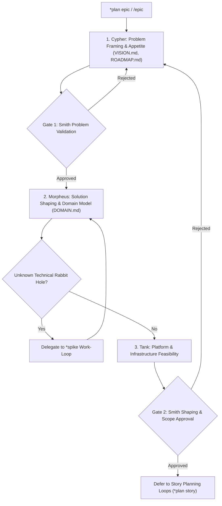

Epic planning and shaping loop: defines problem boundaries, appetite, domain concepts, and milestone roadmap.

TLDR:
    Literature: Ryan Singer (*Shape Up*) & Marty Cagan (*Inspired*).
    Focus: Problem definition, appetite (budgeting, not estimating), domain modeling, and milestone roadmapping without premature implementation.
    Chain: Cypher (Vision & Problem Shaping) → Smith (Problem Validation Gate) → Morpheus (Domain Model & System Architecture) → Tank (Platform Feasibility) → Smith (Final Shaping Review Gate).
    Defers to: Story Planning Loop (`*plan story`).

# Epic Planning & Shaping Loop (`epic`)

## Overview

The `epic` planning loop operates at the strategic macro level of the SDLC. Grounded in Ryan Singer’s *Shape Up* framework and Marty Cagan’s product discovery principles, it solves the "what" and "why" before any engineering capacity is committed. It establishes the appetite, de-risks technical rabbit holes, and models the ubiquitous domain language.

---

## Literature Grounding: Ryan Singer (*Shape Up*) & Marty Cagan (*Inspired*)

> *"Shaping means defining the project at the right level of abstraction: concrete enough that the team knows what to do, yet abstract enough that they have the room to work out the details... We set an appetite (how much time we are willing to spend), identify rabbit holes, and define boundaries before giving the project to a team."*  
> — Ryan Singer, *Shape Up*

In this loop:
1. **Appetite over Estimates**: Instead of asking developers "how long will this take?", Cypher and Smith define how much effort the problem is worth (e.g. "We have a 2-sprint appetite for this initiative").
2. **Domain Model First**: Morpheus formalizes the domain entities and ubiquitous language in [`_template_DOMAIN.md`](file:///home/drusifer/Projects/bob_protocol/agents/templates/_template_DOMAIN.md) to ensure shared understanding across business and engineering.
3. **De-risking**: If a critical technical unknown emerges, the Epic loop pauses and triggers a `*spike` work-loop before completing the shape.

---

## The `epic` Lifecycle



---

## Step-by-Step Procedure

### Step 1: Cypher — Problem Framing & Appetite
- Define the customer/business problem statement and desired outcomes in `VISION.md`.
- Establish the appetite: budget of sprints/milestones allocated for this initiative.
- Identify "no-gos": explicit boundaries of what will NOT be built.
- **Handoff:**
  ```bash
  bobp chat "Epic shaped: problem framed with appetite. @Smith *user review epic" --persona Cypher --cmd "pm handoff" --to Smith
  ```

### Gate 1: Smith — Problem Validation Gate
- Validate that the framed problem addresses genuine user needs and delivers clear value.
- Reject if the problem is poorly formulated or over-scoped for the appetite.

### Step 2: Morpheus — Domain Modeling & System Boundaries
- Model core aggregates, entities, and ubiquitous language using [`agents/templates/_template_DOMAIN.md`](file:///home/drusifer/Projects/bob_protocol/agents/templates/_template_DOMAIN.md).
- Identify system boundaries, integration points, and high-level architectural patterns.
- If a high-uncertainty "rabbit hole" is detected, trigger an isolated `*spike` work-loop to resolve it.

### Step 3: Tank — Platform & Infrastructure Feasibility
- Review cloud resources, hosting capabilities, scaling targets, and platform compatibility.
- Ensure the proposed architecture fits within existing operational budgets and pipelines.

### Gate 2: Smith — Final Shaping Review Gate
- Apply the DOMAIN review rubric from [`agents/templates/ARTIFACTS.md`](file:///home/drusifer/Projects/bob_protocol/agents/templates/ARTIFACTS.md).
- Require explicit `*user approve` before the epic is greenlit for story breakdown.

### Step 4: Deferral to Story Loops
- Epic shaping is complete. Cypher and Morpheus begin decomposing the shaped epic into concrete **Story Loops** (`*plan story`).
