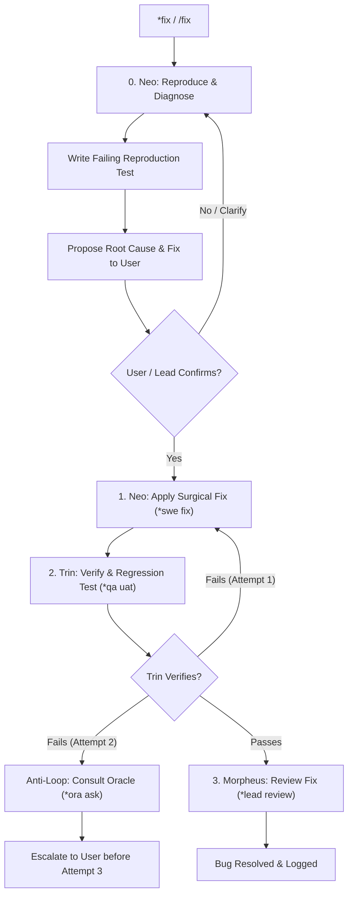

Defect and bugfix work-loop: diagnoses, confirms root cause, and applies targeted fixes with regression tests.

TLDR:
    Literature: David Agans (*Debugging: The 9 Indispensable Rules for Finding the Most Elusive Bugs*).
    Invariant: Reproduce & Diagnose First. Never touch code based on symptoms alone. Write a failing test, diagnose the cause, and confirm with the user/lead before fixing.
    Chain: Neo (diagnose & reproduce) → User/Lead (confirm diagnosis) → Neo (surgical fix) → Trin (verify & regression sweep) → Morpheus (code review).
    Anti-loop rule: If fix fails twice, consult Oracle before retry; escalate to user before attempt 3.

# Bugfix & Defect Work-Loop (`fix`)

## Overview

The `fix` work-loop safely resolves defects, regressions, and broken behavior without causing collateral damage. Grounded in David Agans' foundational debugging disciplines, it mandates that root causes are reproduced and confirmed before any code is modified.

---

## Literature Grounding: David Agans (*Debugging*)

> *"Rule 1: Understand the system. Rule 2: Make it fail. Rule 3: Quit thinking and look... Don't guess. Look at the failure occurring, reproduce it deterministically, and find the real fault before attempting a cure."*  
> — David J. Agans, *Debugging: The 9 Indispensable Rules for Finding the Most Elusive Bugs*

In this work-loop:
1. **Understand & Reproduce**: Neo does not jump straight to editing application files. Neo reproduces the bug with a minimal automated test or repeatable command.
2. **Confirm Diagnosis**: The symptom described by the user is not the diagnosis. Neo explains the root cause and proposed fix to the user or lead, and waits for confirmation.
3. **Surgically Fix**: Neo writes the targeted fix that turns the reproduction test green.
4. **Regression Sweep**: Trin verifies that the bug test passes and that no previously passing tests broke.

---

## The `fix` Lifecycle



---

## Step-by-Step Procedure

### Step 0: Neo — Reproduce & Diagnose First (DO NOT EDIT CODE YET)
- Work out what the bug actually is. The user's input `<thing>` is an observed symptom, not an architectural diagnosis.
- Reproduce the bug reliably: write a minimal failing test or deterministic verification script.
- Locate the root cause in the source code.
- **Explain to User & Pause**:
  Post an explanation to `agents/CHAT.md` detailing:
  1. Observed behavior (what goes wrong).
  2. Expected behavior (what should happen).
  3. Diagnosed root cause.
  4. Proposed minimal fix.
- **STOP and WAIT for user confirmation** before touching production code.

### Step 1: Neo — Surgical Fix (`*swe fix <thing>`)
- Once confirmed, apply the minimal code modification required to address the root cause.
- Run the reproduction test locally via `bobp make test` to verify it now turns green.
- **Handoff:**
  ```bash
  bobp chat "Fix applied for <thing>; reproduction test green. @Trin *qa uat <thing>" --persona Neo --cmd "swe handoff" --to Trin
  ```

### Step 2: Trin — Verification & Regression Sweep (`*qa uat <thing>`)
- Run the reproduction test to verify the defect is resolved.
- Run the entire test suite via `bobp make test` to prove that no regressions or unintended side-effects were introduced.
- **Handoff on Pass:**
  ```bash
  bobp chat "Defect fix verified; zero regressions across suite. @Morpheus *lead review <thing>" --persona Trin --cmd "qa handoff" --to Morpheus
  ```

### Step 3: Morpheus — Code Review (`*lead review <thing>`)
- Review the diff to confirm it is a clean, minimal, non-leaky fix that aligns with existing architecture.
- Approve fix and close the loop.

---

## Anti-Loop Guard

If Neo's fix attempt fails twice:
1. **PAUSE**: Do not attempt a third blind fix.
2. **Consult Oracle**:
   ```bash
   bobp chat "@Oracle *ora ask Have we encountered this bug pattern before? Error: <trace>" --persona Neo --cmd "swe ask" --to Oracle
   ```
3. Allow ONE retry with Oracle's insight.
4. If that fails, escalate to the user with all logs.
