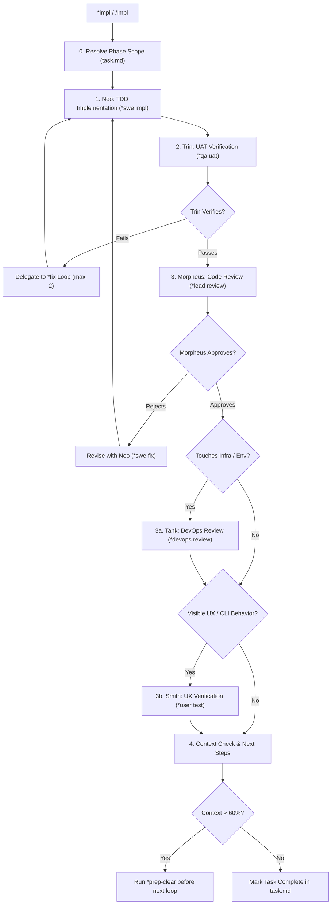

Feature implementation work-loop: executes bounded feature tasks using strict Test-Driven Development (TDD).

TLDR:
    Literature: Kent Beck (*Test-Driven Development: By Example* & *Extreme Programming Explained*).
    Invariant: Test-First. Every new capability must be driven by an observable failing test before production code is written.
    Chain: Neo (TDD: Red-Green-Refactor) → Trin (Verify acceptance) → Morpheus (Code review) → [Tank if infra] → [Smith if UX] → [Context check].
    If verification fails: delegates to `*fix` loop; max 2 failures before Oracle escalation.

# Feature Implementation Work-Loop (`impl`)

## Overview

The `impl` work-loop delivers new user or developer capabilities. Grounded in Kent Beck’s Extreme Programming (XP) and Test-Driven Development, it moves code from requirement to verified production status in short, bounded increments.

---

## Literature Grounding: Kent Beck (TDD & XP)

> *"Write tests before you code. Fast automated tests give developers immediate feedback, maintain system stability, and convert specifications into executable contracts."*  
> — Kent Beck, *Test-Driven Development: By Example*

In this work-loop:
1. **Red**: Neo writes a failing unit/integration test capturing the acceptance criterion.
2. **Green**: Neo writes the minimal code necessary to make the test pass.
3. **Refactor**: Neo cleans up design, removing duplication while keeping tests green.
4. **Accept**: Trin verifies functional acceptance; Morpheus reviews architectural integrity.

---

## The `impl` Lifecycle



---

## Step-by-Step Procedure

### Step 0: Scope Resolution
If `<phase>` is "next phase", read `task.md` or `agents/mouse/state.md` to identify the active phase number. Log resolution to `agents/CHAT.md`.

### Step 1: Neo — TDD Implementation (`*swe impl <phase>`)
- Read phase specifications and acceptance criteria from `USER_STORIES.md` or `task.md`.
- **Test-First (Mandatory)**: Write automated tests reproducing the acceptance criteria *before* creating implementation code.
- Implement minimal, modular code satisfying the tests.
- Run local tests via `bobp make test` (or targeted test runner) to confirm green status.
- **Handoff:**
  ```bash
  bobp chat "Phase <N> implemented with TDD; unit tests green. @Trin *qa uat <phase>" --persona Neo --cmd "swe handoff" --to Trin
  ```

### Step 2: Trin — Acceptance Verification (`*qa uat <phase>`)
- Execute full test suite and phase verification tests via `bobp make test`.
- Verify all declared acceptance criteria for the phase are satisfied.
- **If tests fail**: Do NOT rewrite code as Trin; hand off immediately to Neo via `*fix` with exact failure logs.
- **Handoff on Pass:**
  ```bash
  bobp chat "Phase <N> UAT passed; all tests green. @Morpheus *lead review <phase>" --persona Trin --cmd "qa handoff" --to Morpheus
  ```

### Step 3: Morpheus — Code & Architectural Review (`*lead review <phase>`)
- Audit code changes against architectural standards, modularity, and ADRs in `ARCH.md`.
- Ensure no architectural drift or layer leaks occurred.
- If issues found $\rightarrow$ request surgical revision from Neo.

### Step 3a: Tank — DevOps Gate (Conditional)
*Required if the phase touches dependencies, runtime versions, environment variables, CI configuration, or deployment manifests.*
- Tank reviews infrastructure impact via `*devops review <phase>`.
- Confirms build reproducibility and pipeline safety. Skip if phase is pure application code.

### Step 3b: Smith — UX Evaluation Gate (Conditional)
*Required if the phase introduces or alters human-facing interaction (CLI flags, stdout/stderr formatting, error prompts, interactive UI).*
- Smith tests live running behavior via `*user test <phase>`.
- Evaluates clarity, usability, and feedback ergonomics. Skip if phase is purely internal (e.g. database schema or internal utility).

### Step 4: Context Budget Check
- Check token saturation. If context saturation is $> 60\%$:
  - Advise user to run `*prep-clear` followed by `/clear` before starting the next work loop.

---

## Anti-Loop Guard

If any implementation verification fails more than twice:
1. **STOP** execution immediately.
2. Consult **Oracle**: `bobp chat "@Oracle *ora ask <error>" --persona Neo --cmd "swe ask" --to Oracle`.
3. Allow ONE retry with a fresh approach.
4. If it fails again, halt and escalate to the user with full logs.
