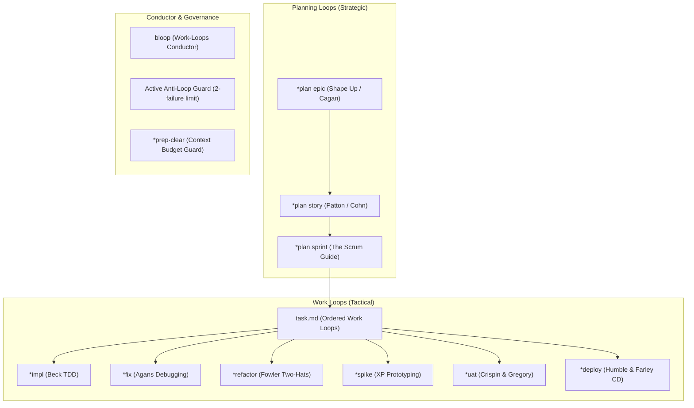

# Building a Restaurant Reservation App with Bob Protocol: A Complete Walkthrough

Welcome to the **Bob Protocol** walkthrough. This guide takes you step-by-step through building a greenfield application from scratch — an automated CLI and API-driven restaurant reservation system called **TableCraft**.

You will learn how to initialize the protocol, coordinate with a specialized 9-persona AI team, execute strategic **Planning Loops**, drive quality through test-first **Work Loops**, and use **Brookhart Rubrics** to ensure production-grade software delivery.

---

## Table of Contents

1. [Mental Model: Personas, Loops, and Invariants](#1-mental-model-personas-loops-and-invariants)
2. [Step 0: Setup & Session Initialization](#step-0-setup--session-initialization)
3. [Step 1: Strategic Planning — The Epic Loop (`*plan epic`)](#step-1-strategic-planning--the-epic-loop-plan-epic)
4. [Step 2: Specification — The Story Loop (`*plan story`)](#step-2-specification--the-story-loop-plan-story)
5. [Step 3: Cadence & Task Board — The Sprint Loop (`*plan sprint`)](#step-3-cadence--task-board--the-sprint-loop-plan-sprint)
6. [Step 4: Tactical Execution — The Work Loops](#step-4-tactical-execution--the-work-loops)
   - [4.1 Feature Implementation Loop (`*impl`)](#41-feature-implementation-loop-impl)
   - [4.2 Context Checkpoint & Safe Reset (`*prep-clear`)](#42-context-checkpoint--safe-reset-prep-clear)
   - [4.3 Defect Diagnosis & Surgical Bugfix Loop (`*fix`)](#43-defect-diagnosis--surgical-bugfix-loop-fix)
   - [4.4 User Acceptance & Usability Loop (`*uat`)](#44-user-acceptance--usability-loop-uat)
7. [Step 5: Sprint Close & Knowledge Harvest](#step-5-sprint-close--knowledge-harvest)
8. [Summary & Key Takeaways](#summary--key-takeaways)

---

## 1. Mental Model: Personas, Loops, and Invariants

Instead of treating the AI as an undifferentiated chatbot writing code in a single prompt, Bob Protocol models a **complete agile software engineering organization**:



### The 9 Specialist Personas

| Persona | Role | Prefix | Primary Focus |
|:---|:---|:---|:---|
| **Bob** | Prompt Engineer & System Custodian | `*prompt` | Skills, agent instructions, system initialization (`*init`) |
| **Cypher** | Product Manager | `*pm` | Business vision, problem framing, user stories, release launch |
| **Morpheus** | Tech Lead & Architect | `*lead` | Domain modeling, system architecture (`ARCH.md`), ADRs, code review |
| **Mouse** | Scrum Master | `*sm` | Sprint cadence, breaking stories into typed Work Loops in `task.md` |
| **Neo** | Senior Software Engineer | `*swe` | Test-driven development (TDD), surgical bugfixing, refactoring |
| **Oracle** | Knowledge Officer | `*ora` | Lessons learned, knowledge base queries, documentation grooming |
| **Smith** | Expert User & UX Advocate | `*user` | Usability audits, ergonomics, review gates (STORIES, ARCH, UAT) |
| **Tank** | DevOps Engineer | `*devops` | SDLC governance (`docs/SDLC.md`), Makefile targets, CI/CD, deploys |
| **Trin** | QA Guardian & SDET | `*qa` | Quality strategy, test execution, regression sweeps, UAT verification |

---

## Step 0: Setup & Session Initialization

You start in a new directory for your restaurant reservation app, `tablecraft`:

```bash
mkdir tablecraft && cd tablecraft
git init
python3 -m venv .venv
source .venv/bin/activate
pip install bobp
```

Scaffold the Bob Protocol framework into your project:

```bash
bobp install .
bobp setup-agent-links
```

This creates the `agents/` workspace, symlinks `.claude/skills/`, and configures team state files.

### Starting Your Session

Open your agent harness (Claude Code, Gemini CLI, Cursor, or Codex) and initialize the session:

```text
User: *init
```

**Bob** initializes the environment, confirms symlink discovery (24 shared skills), reads `agents/CHAT.md`, and prints the team quick reference:

```text
[bob]->[all] *init*:
 Bob Protocol initialized. 9 personas online, 24 skills active, test runner ready. why? Ready for project execution.
```

---

## Step 1: Strategic Planning — The Epic Loop (`*plan epic`)

We start by shaping the business initiative: **TableCraft — Real-Time Restaurant Reservations**.

### 1.1 Triggering the Epic Loop

```text
User: @Cypher *plan epic Restaurant Table Reservations
```

Grounded in Ryan Singer's *Shape Up* and Marty Cagan's *Inspired*, Cypher frames the problem, desired customer outcomes, appetite, and explicit boundaries:

1. **Cypher drafts `VISION.md`**:
   - **Problem**: Walk-in guests face unpredictable wait times; restaurant hosts struggle with manual seating paper charts and accidental double bookings.
   - **Appetite**: 1 sprint (fixed budget, variable scope).
   - **No-Gos (Out of Scope)**: Point-of-Sale (POS) integration, online payment processing, and SMS marketing. Focus strictly on real-time availability and conflict-free booking.

2. **Cypher hands off to Smith for Problem Validation**:
   ```bash
   bobp chat "Epic shaped: problem framed with appetite. @Smith *user review epic" --persona Cypher --cmd "pm handoff" --to Smith
   ```

3. **Gate 1 — Smith Reviews Problem Formulation**:
   Smith confirms the problem statement reflects authentic diner and host pain points:
   ```bash
   bobp chat "*user approve. Problem framing solves genuine dining friction. @Morpheus *lead arch epic" --persona Smith --cmd "user approve" --to Morpheus
   ```

4. **Morpheus models the Domain (`docs/DOMAIN.md`)**:
   Morpheus establishes the ubiquitous domain language and entity boundaries:
   - **Aggregates**: `Restaurant`, `Table` (capacity, status: Active/Inactive).
   - **Entities**: `Reservation` (id, guest_name, guest_contact, party_size, time_slot).
   - **Value Objects**: `TimeSlot` (start_time, duration), `PartySize` (1..12).
   - **Domain Invariants**:
     - *No Overbooking*: A table cannot have overlapping time slots.
     - *Capacity Constraint*: `PartySize <= Table.capacity`.

5. **Technical De-risking via Spike**:
   Morpheus notices a potential rabbit hole: how to handle simultaneous booking requests without race conditions in SQLite. Morpheus delegates an isolated **Spike Loop** (`*spike`):
   - Neo builds a 20-line concurrent script in `scratch/test_locks.py`.
   - Result: SQLite `IMMEDIATE` transactions provide deterministic write locks without lock contention at target load.
   - Outcome documented in `docs/DECISIONS.md` (ADR-001); prototype code is discarded.

6. **Gate 2 — Smith Approves Shaped Epic**:
   Smith reviews `DOMAIN.md` against the Brookhart DOMAIN rubric:
   ```text
   rubric DOMAIN: BOUND=S AGGR=A UBIQ=S CONSTR=S ACTION=A
   ```
   Smith posts `*user approve`. Cypher hands off to the **Story Loop**.

---

## Step 2: Specification — The Story Loop (`*plan story`)

Now we vertically slice the shaped epic into independent, testable user stories with explicit acceptance criteria.

```text
User: @Cypher *plan story Core Reservation Flow
```

Grounded in Jeff Patton's *User Story Mapping* and Mike Cohn's *User Stories Applied*:

### 2.1 Cypher Authors Stories (`docs/sprints/USER_STORIES_SPRINT1.md`)

```markdown
### Story 1: Table Capacity Configuration
As a restaurant host,
I want to configure dining tables with seat capacities,
So that the system knows our seating limits.

- Scenario: Successfully add a table
  Given an empty dining room
  When I register Table "T1" with capacity 4
  Then Table "T1" is saved and available for booking

### Story 2: Conflict-Free Table Booking
As a diner,
I want to reserve a table for my party size and time slot,
So that our table is guaranteed when we arrive.

- Scenario: Successful booking
  Given Table "T1" (capacity 4) has no reservations for 2026-10-15 19:00
  When Party of 3 requests a reservation for 2026-10-15 19:00
  Then the reservation is confirmed with a confirmation code

- Scenario: Rejecting double booking
  Given Table "T1" is reserved for 2026-10-15 19:00
  When another party requests Table "T1" for 2026-10-15 19:00
  Then the request is rejected with "TimeSlotUnavailableError"
```

### 2.2 Gate 1 — Smith Evaluates Stories (STORIES Rubric)

Smith audits the user stories:
```text
[smith]->[cypher] *user review*:
 rubric STORIES: OUT=S TEST=S SCOPE=A FAIL=S SIZE=A DESIGN=A
 Stories approved. Vertical slices clear with testable boundary conditions. @Morpheus *lead arch story
```

### 2.3 Morpheus Authors System Architecture (`docs/ARCH.md`)

Morpheus defines the technical architecture:
- Modular Python service: `tablecraft/domain/`, `tablecraft/services/`, `tablecraft/storage/`, `tablecraft/cli.py`.
- In-memory / SQLite transactional repository implementing the `TableRepository` and `ReservationRepository` protocols.
- Pure domain services with zero external I/O leakage.

### 2.4 Gate 2 — Smith Evaluates Architecture (ARCH Rubric)

```text
[smith]->[morpheus] *user feedback*:
 rubric ARCH: MODUL=S CONTRACT=A DATA=S ERROR=S TRADEOFF=A
 Architecture approved. Boundaries cleanly isolate domain rules from CLI and database. @Trin *qa strategy
```

### 2.5 Trin Establishes Quality Strategy (`docs/TEST_STRATEGY.md`)

Trin defines the testing pyramid:
- **Unit**: Fast isolated domain checks (`tests/unit/`). Target: < 50ms per test.
- **Integration**: Database transaction locks and repository persistence (`tests/integration/`).
- **UAT**: End-to-end CLI booking flows executed directly against running binary.

---

## Step 3: Cadence & Task Board — The Sprint Loop (`*plan sprint`)

With ready specifications, we schedule the sprint container.

```text
User: @Mouse *plan sprint
```

### 3.1 Stage 0: SDLC Gate (Blocker)

Mouse verifies that `docs/SDLC.md` exists. Tank confirms the build environment and Makefile front door:
- `bobp make test`: runs pytest with output capture to `build/build.out`.
- `bobp make lint`: runs ruff check and formatting.

### 3.2 Stage 1: Mouse Structures `task.md` into Typed Work Loops

Mouse breaks the stories into ordered, atomic **Work Loops**:

```markdown
# Sprint 1: TableCraft Core Seating & Booking

## Phase 1: Domain Entities & Table Management
- [ ] Task 1.1: (*impl) Implement Table entity and capacity validation (Neo -> Trin -> Morpheus)
- [ ] Task 1.2: (*impl) Implement Reservation entity and TimeSlot overlapping logic (Neo -> Trin -> Morpheus)

## Phase 2: Booking Service & Concurrency Protection
- [ ] Task 2.1: (*impl) Implement ReservationService with atomic double-booking protection (Neo -> Trin -> Morpheus)
- [ ] Task 2.2: (*uat) End-to-end CLI reservation flow verification (Trin -> Smith -> Cypher)
```

Morpheus approves the task breakdown. Mouse signals the start of execution:
```bash
bobp chat "Sprint 1 task board ready with typed Work Loops. Starting Phase 1. @Neo *impl Task 1.1" --persona Mouse --cmd "sm handoff" --to Neo
```

---

## Step 4: Tactical Execution — The Work Loops

### 4.1 Feature Implementation Loop (`*impl`)

Grounded in Kent Beck's *Test-Driven Development: By Example*: **Test-First Invariant**. No production code may be written without an observable failing test.

#### Step 1: Neo Writes the Failing Test (Red Phase)

Neo reads Task 1.1 and creates `tests/unit/test_table.py`:

```python
import pytest
from tablecraft.domain.table import Table

def test_table_creation_valid_capacity():
    table = Table(id="T1", capacity=4)
    assert table.id == "T1"
    assert table.capacity == 4

def test_table_creation_rejects_zero_or_negative_capacity():
    with pytest.raises(ValueError, match="Capacity must be at least 1"):
        Table(id="T1", capacity=0)
```

Neo runs `bobp make test` to prove the test fails:
```text
=== make test ===
ModuleNotFoundError: No module named 'tablecraft.domain.table'
=== exit 1 ===
```

#### Step 2: Neo Writes Minimal Code (Green Phase)

Neo creates `tablecraft/domain/table.py`:

```python
from dataclasses import dataclass

@dataclass(frozen=True)
class Table:
    id: str
    capacity: int

    def __post_init__(self):
        if self.capacity < 1:
            raise ValueError("Capacity must be at least 1")
```

Neo re-runs `bobp make test`:
```text
=== make test ===
2 passed in 0.04s
=== exit 0 ===
```

#### Step 3: Trin Verifies Acceptance

Trin runs the full suite and audits edge conditions:
```bash
bobp make test
```
Result: 100% green. Trin hands off to Morpheus:
```bash
bobp chat "Task 1.1 unit tests green. Acceptance verified. @Morpheus *lead review Task 1.1" --persona Trin --cmd "qa handoff" --to Morpheus
```

#### Step 4: Morpheus Reviews & Scores (`LOOP_IMPL` Rubric)

Morpheus inspects the diff: pure dataclass, strict validation, no leaky dependencies.
```text
[morpheus]->[all] *lead review*:
 rubric LOOP_IMPL: TFIRST=S VERIF=S MODUL=S REGRESS=S BUDGET=S
 Code clean and modular. Task 1.1 approved. @Mouse *sm done Task 1.1
```

---

### 4.2 Context Checkpoint & Safe Reset (`*prep-clear`)

Between Work Loops, Mouse checks LLM context consumption. If token saturation exceeds **60%**, the agent must execute the **Pre-Clear Protocol** before issuing `/clear` or `/compact`:

```text
User: *prep-clear
```

The active persona executes the canonical checkpoint:
1. Reconciles all pending decisions and completed items in `state.md`.
2. Writes an explicit, step-by-step **Cold-Start Resume Plan** into `state.md`:
   ```markdown
   ## Next Steps
   ### Immediate Next Action
   Execute Task 1.2: Implement Reservation entity and TimeSlot overlapping logic via *impl Task 1.2.
   ### Waiting On
   Neo (*swe impl Task 1.2)
   ```
3. Posts a checkpoint message to `agents/CHAT.md`:
   ```bash
   bobp chat "Checkpoint saved: Task 1.1 complete (100% tests green). Next: Task 1.2 Reservation entity. Ready for context clear." --persona Mouse --cmd checkpoint
   ```

You can now safely type `/clear` in your harness! When restarting:

```text
User: *resume
```

The agent loads `agents/CHAT.md`, detects the checkpoint, loads `agents/mouse/state.md`, and resumes immediately on Task 1.2 with **zero memory loss**.

---

### 4.3 Defect Diagnosis & Surgical Bugfix Loop (`*fix`)

During the development of the booking engine, a tester reports a subtle bug: *Two users booking the same table simultaneously for overlapping slots can both receive confirmation.*

```text
User: *fix double booking race condition on Table T1
```

Grounded in David Agans' *Debugging*: **Reproduce & Diagnose First Invariant**. Never modify application code based on symptoms alone.

#### Step 0: Neo Reproduces and Explains Before Touching Code

Neo writes a concurrent test in `tests/integration/test_concurrency.py`:

```python
import concurrent.futures
from tablecraft.services.reservation import ReservationService

def test_concurrent_reservations_prevent_double_booking(service):
    def book():
        return service.create_reservation(table_id="T1", time="2026-10-15 19:00", party=2)

    with concurrent.futures.ThreadPoolExecutor(max_workers=2) as executor:
        f1 = executor.submit(book)
        f2 = executor.submit(book)
        results = [f1.result(), f2.result()]

    confirmed = [r for r in results if r.success]
    assert len(confirmed) == 1, "Only one booking should be confirmed!"
```

The test fails! Neo identifies the root cause: the reservation check and the table write occur in separate database queries without transaction isolation.

**Neo explains to the user and pauses:**
```text
[neo]->[user] *swe fix*:
 Observed: Both threads see table free before either writes.
 Root Cause: Read and write lack row lock; race condition occurs between check and commit.
 Proposed Fix: Wrap booking in an atomic IMMEDIATE transaction inside SQLite storage layer.
 Awaiting confirmation before editing code.
```

The user (or Morpheus) responds: *"Approved, apply surgical fix."*

#### Step 1: Neo Applies the Surgical Fix

Neo updates `tablecraft/storage/sqlite.py` with an atomic transaction lock:

```python
with self.connection:
    self.connection.execute("BEGIN IMMEDIATE")
    if self._has_overlapping_reservation(table_id, start_time, duration):
        raise ConflictError("Table already reserved for this slot")
    self._insert_reservation(reservation)
```

Neo re-runs `bobp make test`. The reproduction test passes!

#### Step 2: Trin Runs Full Regression Sweep

Trin runs the entire test suite:
```bash
bobp make test
```
Result: 14 passed, 0 failures, zero regressions across prior phases.

#### Step 3: Morpheus Evaluates (`LOOP_FIX` Rubric)

```text
[morpheus]->[all] *lead review*:
 rubric LOOP_FIX: REPRO=S DIAG=S SURG=S NOSIDE=S GUARD=S
 Surgical 6-line fix resolves race condition. Zero side-effects. Bug resolved.
```

---

### 4.4 User Acceptance & Usability Loop (`*uat`)

All tasks in Phase 2 are now coded. Now we critique the running software using Lisa Crispin and Janet Gregory's Agile Testing Quadrants.

```text
User: @Smith *uat Phase 2 CLI reservation flow
```

#### Step 1: Trin Executes Acceptance Matrix

Trin exercises the running CLI against realistic customer booking paths:
- Booking a 2-person table at 7:00 PM: passes, returns booking confirmation `#TC-8492`.
- Attempting to book a 10-person party on a 4-person table: correctly rejected with clear explanation: `Party size (10) exceeds table capacity (4)`.
- Inputting invalid date format: rejected cleanly without Python stack traces.

#### Step 2: Smith Conducts HCI & Usability Audit

Smith evaluates the human experience:
- Is `--help` discoverable and descriptive? Yes.
- Are error messages actionable? Yes, advises the user on next available time slots.
- Is output formatted cleanly? Returns readable tables and JSON flags.

```text
[smith]->[all] *user test*:
 rubric LOOP_UAT: REALIS=S MATRIX=S ERGON=S DEFECT=A GOAL=S
 *user approve. CLI reservation experience is intuitive, responsive, and resilient.
```

#### Step 3: Cypher Signs Off Business Value

Cypher confirms all acceptance criteria from `USER_STORIES.md` are fulfilled without scope creep.

---

## Step 5: Sprint Close & Knowledge Harvest

With all Work Loops passing, Mouse coordinates sprint close:

1. **SDLC Compliance Audit**: Tank runs `*devops sdlc-check` to verify no dependency drift occurred in `pyproject.toml`.
2. **Knowledge Grooming**: Oracle runs `*ora groom` to log key architectural lessons (e.g., SQLite WAL mode locks) to `docs/LESSONS.md` and archive old messages in `agents/CHAT.md`.
3. **Sprint Retrospective**: The team holds a retro (`*sprint retro`). Insights:
   - *Keep*: Spike loops dramatically reduced concurrency bugs upfront.
   - *Improve*: Add `--json` CLI output earlier in Phase 1 for easier automated UAT testing.
4. **Launch**: Cypher announces the release:
   ```text
   [cypher]->[all] *pm launch*:
    TableCraft v0.1.0 released! Core seating and conflict-free booking verified. Changelog updated. Sprint 1 closed.
   ```

---

## Summary & Key Takeaways

By following Bob Protocol on TableCraft, you achieved:

| Challenge in Traditional AI Coding | How Bob Protocol Solved It |
|:---|:---|
| **Hallucinated Features & Scope Creep** | Bounded in **Epic** (`*plan epic`) and **Story** (`*plan story`) loops with Smith review gates before code was written. |
| **Fragile, Untested Code** | **Test-First Invariant** (`*impl`) mandated failing automated tests before minimal production code was introduced. |
| **Collateral Damage & Regressions** | **Reproduce First Invariant** (`*fix`) mandated diagnosing root cause and user confirmation before code edits. |
| **Lost Context & Amnesia** | **Pre-Clear Protocol** (`*prep-clear`) and `state.md` working memory allowed safe `/clear` resets with zero lost progress. |
| **Endless Retry Loops** | **Active Anti-Loop Guard** stopped execution after 2 failures and escalated to Oracle and the user. |
| **Subjective "Looks Good" Approvals** | **Brookhart Rubrics** evaluated deliverables and loop effectiveness against observable, empirical criteria. |

---

### Command Quick Reference

```bash
# Lifecycle
*init                          # Initialize session and ready team
*resume                        # Cold-start recovery from last handoff
*prep-clear                    # Checkpoint state before /clear

# Planning Loops
*plan epic <name>              # Problem framing, appetite, domain model
*plan story <slice>            # User stories, acceptance criteria, ADRs
*plan sprint                   # Sprint container, task board breakdown

# Work Loops
*impl <task>                   # Test-Driven Development (TDD) feature loop
*fix <defect>                  # Reproduce & diagnose defect fix loop
*refactor <target>             # Behavior-preserving refactoring loop
*spike <topic>                 # Timeboxed disposable exploration loop
*uat <scope>                   # End-to-end acceptance & usability loop
*deploy <env>                  # Pipeline deployment & smoke test loop
```
