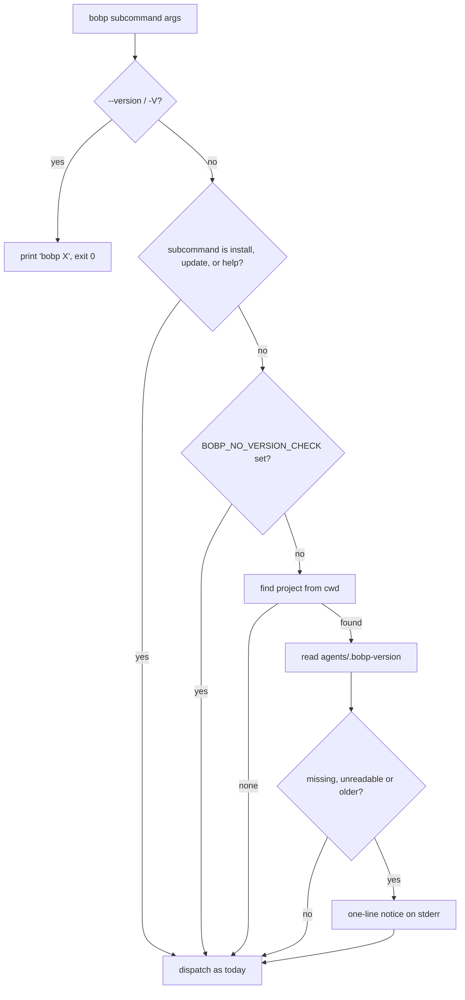

# Sprint 2 User Stories: Version-Aware bobp

*   **Planning Size** (optional): omit
*   **Branch**: none — the SDLC (§6) has no sprint branch; work lands on `main` and is committed only when the user directs
*   **Source**: the owner, in the `/sprint` request of 2026-11-01 ("make bobp version aware…"), plus two answers given the same day (see Assumptions)
*   **Status**: Draft — awaiting Smith Gate 1

## Goal

After this sprint, `bobp --version` reports the installed version, and every project remembers which bobp last set it up. When someone runs bobp in a project that was set up by an older bobp, or by one that never recorded a version, bobp prints the command to update the project and then carries on with what was asked. This stops projects from silently running stale skills, templates and personas after bobp is upgraded.

## Out of scope

- Updating a project automatically, or asking the user whether to update.
- Checking PyPI or the network for a newer bobp release.
- Warning when a project is stamped newer than the running bobp, or downgrading.
- Remembering that a user has already seen the notice.
- Changing the bobp version number or cutting a release (a separate decision under SDLC §6/§7).
- Comparing pre-release suffixes (`rc`, `dev`) as distinct versions.

## Assumptions made for the owner

The owner decided the behavior; the rest were decided on their behalf and can be overturned.

Owner decisions (2026-11-01):
1. bobp never asks a question and never updates a project by itself. It prints the instruction to update and continues the command.
2. The instruction is printed on every run while the project is behind (there is no "remember I was told").

Decided on the owner's behalf:
3. "tank teh current bobp" was read as "than the current bobp": notify when the recorded version is missing or **older than** the running bobp.
4. A project recorded as **newer** than the running bobp is left alone, with no message. Downgrading is not this sprint's concern.
5. The instruction goes to stderr, so stdout that scripts parse is never changed.
6. `BOBP_NO_VERSION_CHECK=1` turns the check off, for CI and scripted use.
7. The recorded version is a committed file in the project, so a team shares one answer to "which bobp set this up".

---

## STORY-BOBP-1: Ask bobp its version
**Owner:** Neo

**As a** person using or reporting a problem with bobp,
**I want** to run `bobp --version`,
**so that** I know exactly which release I have without opening files or asking pip.

### Acceptance Criteria
1. `bobp --version` prints `bobp <version>` (for example `bobp 0.2.0`) on one line and exits 0.
2. `bobp -V` does the same.
3. The version printed is the same one the package is built with (`bobp.__version__`); there is no second place to bump.
4. `bobp --version` works anywhere, including outside a project, and never prompts or touches any file.
5. `bobp --help` lists `--version`.

## STORY-BOBP-2: A project records which bobp set it up
**Owner:** Neo

**As a** project owner,
**I want** `bobp install` and `bobp update` to record the bobp version they used,
**so that** later runs can tell whether the project is behind.

### Acceptance Criteria
1. After a successful `bobp install <dir>`, `<dir>/agents/.bobp-version` exists and contains the running bobp version on one line.
2. After a successful `bobp update <dir>`, that file is created or overwritten with the running bobp version.
3. If install or update fails or exits early, the file is not changed.
4. `bobp update` still preserves state files, chat logs and project-specific files exactly as it does today; the new file is the only addition.

## STORY-BOBP-3: Be told when a project is behind
**Owner:** Neo

**As a** person running bobp inside a project,
**I want** bobp to notice that the project was set up by an older bobp (or by one that recorded nothing) and tell me how to update it,
**so that** I can choose to update instead of unknowingly working with stale skills and personas.

### Acceptance Criteria
1. Running any bobp subcommand inside a project (an `agents/` directory at or above the current directory) compares `agents/.bobp-version` with the running bobp version.
2. If the file is missing, empty or not a readable version, or holds a version older than the running bobp, bobp prints one line to stderr stating the project's version (or that none is recorded), the running version, and the exact command to run (`bobp update <project>`).
3. bobp then runs the original subcommand normally, with the same output and exit code as without the check. It never asks a question and never changes the project itself.
4. The line is printed on every run while the project is behind, and stops once `bobp update` has recorded the current version.
5. If the file holds the same version, or a newer one, bobp prints nothing.
6. `bobp install`, `bobp update`, `bobp --version` and `bobp --help` never trigger the check; outside a project nothing is checked.

## STORY-BOBP-4: Scripts and agents are not disturbed
**Owner:** Neo

**As an** agent or CI job calling bobp (for example `bobp chat`, `bobp make`),
**I want** the version check to stay out of my output and be switchable off,
**so that** scripted runs behave exactly as before.

### Acceptance Criteria
1. The notice goes only to stderr; stdout is never changed by the check, so output that scripts parse is unaffected.
2. With `BOBP_NO_VERSION_CHECK=1` set, bobp performs no check and prints nothing.
3. bobp never reads stdin for the check, so it cannot hang a non-interactive run.
4. Any failure in the check itself (unreadable file, odd contents) is swallowed, at most producing the one notice line; the subcommand still runs and returns its normal exit code.

---

# Architecture

*   **Status**: Draft — awaiting Smith Gate 2 and Switch design gate

## 1. Executive Summary & System Overview

Add a small notify-only version-check step to the `bobp` dispatcher, a one-line version stamp written by `install` and `update`, and a `--version` flag. No new dependency, runtime, make target or workflow; this is an ordinary feature under the SDLC (§6 Routine).

## 2. System Context & Boundaries

Boundaries: the check lives entirely inside `bobp.cli.main()` before a subcommand module is imported. It reads one file, `<project>/agents/.bobp-version`, and writes at most one line to stderr. It never modifies the project and never reads stdin. It does not contact any network service and does not change how any subcommand parses its arguments.

Trust boundary: the stamp file lives in the project and may come from a cloned repository, so its contents are untrusted text.

## 3. Component & Container Architecture

### Component Inventory

| Component | Responsibility | Change |
|---|---|---|
| `bobp/__init__.py` | single source of `__version__` | unchanged |
| `bobp/cli.py` | handle `-V/--version`; list it in help; call the check before dispatch for every subcommand except `install`, `update` | edit |
| `bobp/tools/_version_check.py` | find the project, read and parse the stamp, compare, print the update notice | new |
| `bobp/tools/_common.py` | `find_project_root()` exits when no project is found; add a non-exiting variant `find_project_root_or_none()` so the check can silently skip | edit |
| `bobp/tools/_bob_manage.py` | `install()` and `update()` write the stamp as their last step; `STAMP_NAME` constant lives here and is imported by the check | edit |
| tests | `tests/test_version_check.py` (new); `tests/test_bob_manage.py` (stamp cases) | new/edit |

## 4. Runtime Interaction & Critical Flows

The whole check is wrapped so that any exception is swallowed (at most the one notice line) and dispatch continues.

## 5. Interface & Contract Specifications

- `bobp --version` / `bobp -V` → stdout `bobp <__version__>\n`, exit 0. Handled before subcommand lookup, so it works with no project.
- Stamp file: `agents/.bobp-version`, UTF-8, one line, the bare version string, trailing newline. Absent file means "no version recorded".
- Version comparison: take the leading dot-separated integers of each string (`0.2.0` → `(0,2,0)`; `0.2.0rc1` → `(0,2,0)`), padded with zeros, compared as tuples. A stamp with no leading integers counts as "not a readable version", the same as missing. No new dependency (no `packaging`).
- Notice text, a single line on stderr: `bobp: this project was set up with <bobp X | an unrecorded bobp version>; installed is bobp <Y>. Run: bobp update <project>`, where `<project>` is the discovered project root, shell-quoted (`shlex.quote`) so the printed command is safe to paste when the path contains spaces or metacharacters. Control characters are stripped from every echoed value, the stamp text and the path alike (Switch design review, low).
- Environment: `BOBP_NO_VERSION_CHECK` set to any non-empty value other than `0` disables the check.

## 6. Cross-Cutting Concepts & Resilience

### Failure Modes & Error Handling

| Failure | Behavior |
|---|---|
| Stamp unreadable (permissions, directory, not UTF-8) | treated as "no version recorded"; the notice applies |
| Any unexpected exception in the check | swallowed; the subcommand still runs with its normal output and exit code |
| Running bobp older than the stamp | silent |
| Concurrent runs (two agents) | each may print the notice; the check only reads, so there is no shared state and no lock needed |

### Security & Privacy

- The stamp is untrusted: it is only parsed for leading integers and is never executed, evaluated or placed in a shell command. When echoed in a message, control characters are stripped and length is capped (e.g. 40 chars), to prevent terminal-escape injection from a hostile repository.
- Hostile stamp files (SEC-005, found at the Phase 2 security review): the stamp is opened with `O_NOFOLLOW | O_NONBLOCK`, must be a regular file, and at most 256 bytes are read. A symlink (for example to `/dev/stdin`) or a FIFO therefore counts as "no version recorded" instead of hanging every bobp command.
- No side effects: the check only reads the stamp and prints; it never writes files, runs commands or reads stdin. The path shown in the notice is the discovered project root, never a path taken from the stamp.
- No network access, no telemetry, no new secrets.

## 7. Technical Stack & SDLC / Build Impact

No new language, dependency, package manager, runtime or make target; no build-environment change, so no Phase 0 for Tank. The release process is unchanged. The only SDLC text to touch is a sentence in §7 noting that the installed bobp version is recorded in projects at `agents/.bobp-version` (a Tank proposal, made at sprint close). This repository's own `agents/` will be offered an update the first time bobp runs in it, which also serves as a live check.

## 8. Architectural Decisions (ADRs) & Technical Debt

### Decision Records

| ID | Decision | Alternatives rejected | Why |
|---|---|---|---|
| ADR-S2-1 | The stamp is `agents/.bobp-version`, committed with the project | gitignored per-machine file; field in `agents/PROJECT.md` | It answers "which bobp set up this project", which is a project fact shared by a team. A dedicated one-line file is trivial to read and write without parsing Markdown. `PROJECT.md` is generated by `setup-agent-links` and read by personas, so it should not double as machine state |
| ADR-S2-2 | Check in `cli.main()` before dispatch, for all subcommands | check inside each tool | One place, no per-tool changes, and tools keep parsing their own `sys.argv` |
| ADR-S2-3 | Notify only: print the update command to stderr and continue | interactive y/N prompt that runs the update; auto-update | Owner decision (2026-11-01). Agents call bobp from non-interactive shells constantly, so a prompt could hang them, and the check can never modify a project |
| ADR-S2-4 | Hand-rolled leading-integer comparison | `packaging.version` | Avoids a new dependency (a Tank mechanism change) for one comparison; bobp's own versions are plain `X.Y.Z` |
| ADR-S2-5 | Notice on every run while behind; no persisted "already told" state | remember the notice per version | Owner's "ask every run" choice (2026-11-01); keeps the check read-only |

### Acknowledged Technical Debt & Trade-offs

- Pre-release suffixes are ignored in comparison (`0.3.0rc1` equals `0.3.0`); acceptable while releases are plain versions.
- Every bobp command in a stale project prints one stderr line, including the many `bobp chat` calls agents make. That noise is the price of the owner's "every run" choice; `BOBP_NO_VERSION_CHECK=1` is the opt-out.
- If a team member runs an older bobp than the stamp, they get no warning; this is deliberate (assumption 4).
