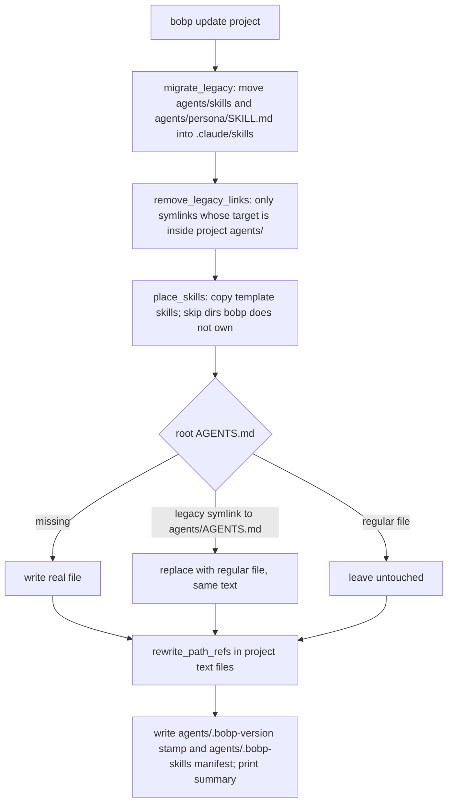

# Sprint 3 User Stories: Spec-Compliant Skills, No Links

## Owner amendment — 2026-11-01

The final skill directory is `.agents/skills/`, with real files and no discovery links. The earlier `.claude/skills/` requirements below describe the approved intermediate design; apply every layout acceptance criterion to `.agents/skills/` for final acceptance. Existing Bob Protocol copies in `.claude/skills/` are removed during update. Claude Code will not discover these skills, while Codex, Gemini CLI, Cursor, and Copilot can use the final directory. The owner also directed `.claude` to be ignored again. No commit or release is included in the sprint.

*   **Planning Size** (optional): omit
*   **Branch**: none — the SDLC (§6) has no sprint branch; work lands on `main` and is committed only when the user directs
*   **Source**: the owner, 2026-11-01 ("simplify the setup script now that there is a standard for agent files… not have all the links"; "adhere to https://agentskills.io/specification"; "our test cases should be in evals/evals.json"), plus the answers recorded below
*   **Status**: Draft — awaiting Smith Gate 1

## Goal

After this sprint, a project that has Bob Protocol installed holds its personas and shared skills as real, spec-conformant Agent Skills directories in `.claude/skills/<name>/SKILL.md`, its shared instructions as a real root `AGENTS.md`, and no symlinks created by bobp. `bobp install`/`update` stop wiring discovery links for each tool, existing projects are migrated cleanly, and the skill test cases live in each skill's own `evals/evals.json` in the Agent Skills format. The skills themselves are also brought in line with the Agent Skills best-practices guide: no skill over the size limit, descriptions that say when to use the skill, Gotchas sections where real gotchas are known, and no stray content. This removes a setup script that is hard to reason about and aligns the project with the published standards.

## Out of scope

- Making Codex or Gemini CLI discover the skills. They read `.agents/skills/`, which this sprint does not create (owner chose `.claude/skills` with no links). Documented as a limitation.
- Configuring any tool's own settings (for example Gemini's `context.fileName`).
- Publishing skills to a registry, or adding skill versioning or `license` fields.
- Changing what any skill or persona tells agents to do, beyond path references and the best-practice fixes in STORY-SKL-5 (trimming, moving detail to `references/`, Gotchas, descriptions, conditional pointers).
- Changing the via MCP setup, `PROJECT.md` capability handling, or `.gitignore` entries.
- Committing or releasing (a separate decision under SDLC §6/§7).

## Assumptions made for the owner

Owner decisions (2026-11-01):
1. Skills and personas live as real files in `.claude/skills/` with **zero links**.
2. Skills conform to the Agent Skills specification (`agentskills.io/specification`).
3. Test cases live in `evals/evals.json`.

Decided on the owner's behalf:
4. The root `AGENTS.md` is written by `bobp install` only when it is missing; `bobp update` never overwrites an existing one. (The owner's reply "4" matched neither offered option, so the safer create-only behavior was taken.)
5. "Test cases in `evals/evals.json`" means the persona-evaluation cases now in `catalog.json`, stored the way the Agent Skills guidance says: one file per skill at `<skill>/evals/evals.json`, not one repo-wide file. The pytest tests for bobp's code stay where they are.
6. Persona memory (`state.md`, lessons, findings, sprint log) stays in `agents/<persona>/`; it is project state, not part of a skill.
7. bobp never overwrites or deletes a skill in `.claude/skills/` that it did not place itself.

---

## STORY-SKL-1: Skills are real, spec-conformant directories in `.claude/skills/`
**Owner:** Neo

**As a** project owner using Claude Code (and Cursor or Copilot, which also read `.claude/skills/`),
**I want** every Bob Protocol persona and shared skill to be an ordinary skill directory,
**so that** my tools find them with no symlinks and any spec-aware validator accepts them.

### Acceptance Criteria
1. After `bobp install <dir>`, each of the 10 personas and each shared skill exists as `<dir>/.claude/skills/<name>/SKILL.md`, a regular file, and nothing under `.claude/skills/` is a symlink.
2. Every installed `SKILL.md` satisfies the specification: the directory name equals `name`; `name` is lowercase letters, digits and single hyphens, at most 64 characters, not starting or ending with a hyphen; `description` is present and at most 1024 characters; frontmatter contains only `name`, `description`, `license`, `compatibility`, `metadata`, `allowed-tools`.
3. A test fails if any packaged skill breaks criterion 2.
4. Persona memory files stay in `agents/<persona>/`; no `state.md` or lessons file appears in `.claude/skills/`.
5. After `bobp update`, skills are refreshed from the packaged templates, and persona state files, chat history and lessons are untouched.
6. If `.claude/skills/<name>/` already exists and bobp did not place it, bobp leaves it alone and prints which skill it skipped and why.
7. Instructions and skills that refer to other skills or personas use the new paths, so no shipped file points at `agents/skills/...` or `agents/<persona>/SKILL.md`.

## STORY-SKL-2: Setup creates no links, and old links are cleaned up
**Owner:** Neo

**As a** project owner,
**I want** `bobp install` and `bobp update` to stop creating symlinks and to remove the ones older bobp versions made,
**so that** my project has one real copy of everything and no dangling or confusing links.

### Acceptance Criteria
1. `bobp install` and `bobp update` create no symlinks anywhere (project root, `.github/`, `.claude/`, `.agents`, or the Codex home), and the Codex skill registration is gone.
2. `bobp update` on a project from an earlier layout moves the old `agents/skills/<name>/` and `agents/<persona>/SKILL.md` into `.claude/skills/<name>/`, and moves `agents/AGENTS.md` to a real root `AGENTS.md`.
3. `bobp update` removes the legacy links bobp created: root `AGENT.md`, `GEMINI.md`, `.cursorrules`, `CHATGPT.md`, `.github/copilot-instructions.md`, `.agents`, `agents/AGENT.md`, and the per-skill symlinks in `.claude/skills/`. It removes a link only if it is a symlink whose target is inside the project's `agents/` directory (or `agents/AGENTS.md`); a real file, or a link pointing anywhere else, is never touched.
4. Text in the project that cites the old paths is rewritten to the new ones; chat logs and the chat archive are left as they are (history).
5. Running `bobp update` a second time changes nothing and reports nothing to migrate.
6. `bobp update` prints a short summary of what it moved and removed.

## STORY-SKL-3: A real root AGENTS.md
**Owner:** Neo

**As a** person using Claude Code, Codex, Cursor or Copilot,
**I want** the shared instructions in a plain `AGENTS.md` at the project root,
**so that** every tool that follows the AGENTS.md standard reads it without any link.

### Acceptance Criteria
1. `bobp install` writes `<dir>/AGENTS.md` as a regular file when none exists.
2. If a root `AGENTS.md` already exists as a regular file, install and update leave its content untouched.
3. If the root `AGENTS.md` is a legacy symlink to `agents/AGENTS.md`, update replaces it with a regular file containing the same text.
4. No `agents/AGENTS.md` remains after install or after a migrating update.
5. The text shown by `bobp install` and `bobp update` and the README state that Gemini CLI needs `context.fileName` including `AGENTS.md`, and that Codex and Gemini CLI do not read `.claude/skills/`.

## STORY-SKL-4: Skill test cases are in `evals/evals.json`
**Owner:** Neo

**As a** maintainer who changes a persona or skill,
**I want** its test cases in that skill's own `evals/evals.json` in the Agent Skills format,
**so that** standard tooling can read them and I find a skill's tests beside the skill.

### Acceptance Criteria
1. Each of the 11 cases now in `bobp/tools/persona_eval_assets/catalog.json` exists in the `evals/evals.json` of the skill it tests (`skill_name` is that skill), with an integer `id`, a `prompt`, an `expected_output`, and `assertions` as a list of strings. Cases that need fixture files list them in `files`.
2. `bobp persona-eval --list` shows the same 11 cases by the same names as before; `bobp persona-eval <persona-or-suite>` selects them as before.
3. The evaluator reads the `evals/evals.json` files; `catalog.json` is removed, and no code or document refers to it.
4. A malformed `evals.json` (missing field, duplicate `id`, non-list `assertions`, a path escaping the skill directory) fails with a message naming the file and the problem.
5. The per-case settings the evaluator needs beyond the standard fields (target persona, artifact path, rubric file, evaluation scope, tags) are kept in one clearly named object inside each eval, so the standard fields stay exactly as the guidance defines them.
6. The cases are installed with their skill, so a project can run them.
7. `bobp persona-eval` writes its results in the layout from https://agentskills.io/skill-creation/evaluating-skills (owner request, 2026-11-01): a workspace `<skill>-workspace/iteration-N/` under `build/persona-eval/` (never `/tmp`), one `eval-<short-name>/` folder per case, and inside it a `with_skill/` run and a baseline run, each holding `outputs/`, `timing.json` (`total_tokens`, `duration_ms`) and `grading.json`.
8. A baseline run is available with `--baseline without-skill` (the same request with the skill removed and the sentence pointing at it dropped, recorded as `without_skill/`) or `--baseline previous` (the skill version evaluated last time, kept in `<skill>-workspace/skill-snapshot/` and run as `old_skill/`; without a snapshot it falls back to `without_skill/` and says so). It is opt-in because it doubles the Codex and Jev calls, which are paid and external; the default records only `with_skill/`. A baseline result is recorded but never makes the suite fail.
9. `grading.json` holds one entry per graded check — `{text, passed, evidence}` — plus a `summary` with `passed`, `failed`, `total` and `pass_rate`. The graded checks are the ones the evaluator actually makes: the skill-use check and each rubric or behavior criterion Jev classifies; the evidence is Jev's reason for that check. The eval's `assertions` strings state the intent and are copied into `grading.json` as `declared_assertions` (they are not graded one-to-one, because the grader works from the rubric).
10. Each iteration folder has a `benchmark.json` with `run_summary` for the skill run and the baseline (`pass_rate`, `time_seconds`, `tokens`, each with `mean` and `stddev`) and the `delta` between them. A new iteration gets a new `iteration-N` folder; earlier ones are never overwritten.
11. A reviewer's notes can be saved beside the iterations as `feedback.json` (case folder name → note), and `bobp persona-eval` leaves that file alone on later runs.
12. The existing report and the Jev/TypeSafe grading keep working; they feed `grading.json` rather than being replaced, and the report states which iteration and which baseline it compared.

## STORY-SKL-5: Skills follow the Agent Skills best-practices guide
**Owner:** Bob (skill content), Neo (checks)

**As an** agent loading a Bob Protocol skill,
**I want** each skill to be small, to say when it applies, and to warn me about known traps,
**so that** I load only what I need and avoid mistakes the team has already made.

Source of the criteria: https://agentskills.io/skill-creation/best-practices (audit of 2026-11-01).

### Acceptance Criteria
1. Every shipped `SKILL.md` is under 500 lines and 5,000 tokens (estimated as characters ÷ 4), with at least 10% margin so a small edit does not break the limit. `sprint` (430 lines, about 5,460 tokens) and `build-env` (335 lines, about 4,970 tokens) are reduced by moving detail they only need in certain situations into `references/` files inside the skill.
2. Wherever `SKILL.md` points to a `references/` file it says when to read it (for example "Read `references/close.md` when the sprint reaches Stage 3"), not a bare "see references".
3. Every one of the 35 descriptions states what the skill does and when to use it ("Use when …"), within 1024 characters. The 18 that currently lack a trigger (`bloop`, `deploy`, `epic`, `fix`, `impl`, `init`, `judge`, `linter`, `make-discover`, `prep-clear`, `refactor`, `render`, `security`, `spike`, `sprint`, `story`, `uat`, `via`) are rewritten.
4. Skills with recorded, environment-specific traps gain a `## Gotchas` section stating those facts. At minimum: `make` (the `distclean` wrapper crash), `security` (untrusted project files must not be followed or blocked on, SEC-005), `bob-protocol` (the anti-loop guard and state-file rules), `sprint`, and `build-env`. Each gotcha names a real, checkable fact from a lesson, finding or SDLC deviation; no generic advice is added to fill a section.
5. Bare "See instructions here -> `<path>`" pointers are replaced by pointers that say when to follow them ("Read … if/when …").
6. No shipped skill or template names another organization or project (the `render` skill currently says "InvestaCo"); organization-specific content is generalized or removed.
7. A test fails if a shipped skill exceeds the size limit, lacks a "when to use" in its description, or contains a `references/` pointer with no condition.
8. Stray generated files (for example `agents/tools/__pycache__/`) are removed from the repository's `agents/` directory and ignored.
9. Because persona and skill text changes, Trin runs the matching `bobp persona-eval` suites for the changed personas before sign-off (SDLC §5).

## STORY-SKL-6: bobp subcommands are safe for an agent to run
**Owner:** Neo (code), Bob (skill text)

**As an** agent running bobp from a non-interactive shell,
**I want** every subcommand to explain itself without acting, to preview anything destructive, and to report failures consistently,
**so that** I can learn the interface and retry safely without changing a project by accident.

Source of the criteria: https://agentskills.io/skill-creation/using-scripts (audit of 2026-11-01, which found `bobp setup-agent-links --help` running the whole setup and refreshing global Codex links).

### Acceptance Criteria
1. `bobp <subcommand> --help` and `-h` print usage and exit 0 for every subcommand, and change no file and no setting outside the process. This includes `setup-agent-links`, `tldr` and `make`; `bobp make --help` describes bobp's wrapper (the project's own make help stays available as `bobp make help`).
2. A test runs `--help` for every registered subcommand in a scratch project and fails if any file under the project, the user's home or the Codex home changes.
3. `bobp update`, `bobp pull` and `bobp clean` accept `--dry-run`: they list what would be created, overwritten, moved, removed or reset, change nothing, and exit 0.
4. `bobp clean` resets persona state and the chat log, so without `--yes` it prints what it would reset, tells the user to re-run with `--yes`, changes nothing, and exits 2. The docs that mention `bobp clean` (`bobp/templates/README.md`) show `--yes`.
5. Each subcommand's `--help` ends with its exit codes: 0 success, 1 failure, 2 invalid usage or confirmation required.
6. `bobp persona-eval --list --json` prints the cases as a JSON array on stdout and nothing else there.
7. Progress and status lines of `install`, `update`, `pull`, `clean` and `diff` go to stderr; their final result lines stay on stdout. (The owner may drop this item: it changes where text appears for anyone parsing that output.)
8. The `linter` skill's install command pins versions (or uses `uv` with a lockfile), and the `render` example does not run an unpinned install.
9. Every skill whose instructions run `bobp` commands has a `compatibility` field saying it needs the bobp CLI on `PATH` and how to install it; a test enforces this.
10. No shipped skill refers to the removed `agents/tools/` directory.

---

# Architecture

*   **Status**: Draft — awaiting Smith Gate 2 and Switch design gate

## 1. Executive Summary & System Overview

Skills and personas become ordinary Agent Skills directories in `.claude/skills/`, installed by copying (never linking). One new module owns every operation on that layout (place, migrate, clean up legacy links, rewrite path references); `setup_agent_links` shrinks to via MCP, `PROJECT.md` and `.gitignore`. Evaluation cases move from one packaged `catalog.json` to per-skill `evals/evals.json`. Skill text is trimmed and corrected against the two best-practices guides, and the CLI gets uniform, side-effect-free `--help`. No new dependency, runtime, make target or workflow; this is an ordinary change under SDLC §6, though it edits SDLC §3/§7 text (Tank proposes at close).

## 2. System Context & Boundaries

The unit of change is a project directory (`<project>/`). bobp reads the packaged templates (`bobp/templates/agents/**`, unchanged layout) and writes only inside `<project>`: `.claude/skills/`, `agents/`, root `AGENTS.md`, `.gitignore`, `.mcp.json`. It no longer writes to the Codex home, `.github/`, or any root-level link.

Trust boundaries: (1) the target project may be a cloned repository, so its symlinks, file names and `.claude/skills/` contents are untrusted; (2) `evals.json` is data from the package or the project and its `files`/artifact paths must stay inside the disposable fixture.

## 3. Component & Container Architecture

### Component Inventory

| Component | Responsibility | Change |
|---|---|---|
| `bobp/tools/_skill_layout.py` | constants (`SKILLS_DIR=".claude/skills"`, manifest `agents/.bobp-skills`); `place_skills()`; `migrate_legacy()`; `remove_legacy_links()`; `rewrite_path_refs()`; each takes `dry_run` and returns a plan/result list | new |
| `bobp/tools/_bob_manage.py` | `install`/`update`/`pull`/`clean`/`diff` call `_skill_layout`; write root `AGENTS.md` create-only; add `--dry-run`/`--yes`; progress to stderr | edit |
| `bobp/tools/setup_agent_links.py` | keep via MCP, `PROJECT.md`, `.gitignore`, legacy-layout migration of persona folders; delete `create_symlink`, `setup_claude_skills`, `setup_codex_skills`, `setup_root_symlinks`; gains argparse and `--help` | edit |
| `bobp/tools/teardown_agent_links.py` | becomes the legacy-link remover (delegates to `_skill_layout.remove_legacy_links`); keeps `--dry-run` | edit |
| `bobp/cli.py` | uniform `-h/--help` handling before any module `main()` runs; subcommand help text | edit |
| `bobp/tools/persona_eval.py` | `load_evals()` reads per-skill `evals/evals.json` (packaged templates); `catalog.json` removed; `--list --json` | edit |
| `bobp/templates/agents/**/evals/evals.json` | the 11 cases, moved to the skill each tests | new/moved |
| `bobp/templates/agents/**/SKILL.md.txt` | path references updated; size, descriptions, Gotchas, `compatibility`, conditional pointers; `sprint` and `build-env` gain `references/` | edit |
| tests | `test_skill_spec.py` (spec + best-practice checks over packaged skills), `test_skill_layout.py`, `test_cli_help.py`, updates to `test_bob_manage.py`, `test_setup_agent_links.py`, `test_persona_eval.py` | new/edit |

## 4. Runtime Interaction & Critical Flows

`--dry-run` runs the same functions with `dry_run=True`, which build and print the plan and perform no writes. Every step is idempotent: a second run finds nothing to move, remove or rewrite.

## 5. Interface & Contract Specifications

- Layout: `<project>/.claude/skills/<name>/SKILL.md` (+ optional `references/`, `evals/`), regular files only. Persona memory stays in `agents/<persona>/`.
- Ownership manifest `agents/.bobp-skills`: one skill name per line, UTF-8, regular file. `place_skills` replaces a skill directory only if its name is listed or it is a legacy bobp symlink; otherwise it skips it and reports it (STORY-SKL-1 AC6). Names read from the manifest are validated against the spec name pattern before use, so a hostile manifest cannot cause a path to escape `.claude/skills/`. The manifest lists only names that exist in the packaged templates. When `migrate_legacy` moves a skill directory from `agents/skills/` whose name is not a packaged one (a project's own skill), it moves it but does not list it, so a later `update` never overwrites it (Switch design review, low).
- `evals.json` (per skill): `{"skill_name": str, "evals": [{"id": int, "prompt": str, "expected_output": str, "files": [str], "assertions": [str], "bobp": {...}}]}`. Standard fields exactly as the guidance defines them. The `bobp` object holds `suite` (the existing slug, so CLI names are unchanged), `persona`, `artifact`, `rubric`, `evaluation_scope`, `behavior_criteria`, `tags`. `id` unique within a file; `files`, `artifact` and `rubric` paths validated to stay inside the fixture.
- Eval discovery: all `agents/*/evals/evals.json` and `agents/skills/*/evals/evals.json` under the packaged templates (installed copies in `.claude/skills/` are identical).
- CLI: `bobp  -h|--help` exit 0, no side effects. `--dry-run` on `update`, `pull`, `clean`; `clean` requires `--yes` (exit 2 otherwise). Exit codes 0/1/2 listed in each help epilog. `persona-eval --list --json` → array of `{suite, persona, skill, tags}` on stdout.
- Spec/best-practice checks (test-enforced over packaged skills): directory-name = `name`; name pattern and length; description 1–1024 chars and contains "use when" or "use for"/"use to" phrasing; only spec frontmatter keys; ≤500 lines and ≤4,500 tokens (chars ÷ 4, a 10% margin); every `references/` pointer is conditional; any skill whose body runs `bobp` has `compatibility`.

## 6. Cross-Cutting Concepts & Resilience

### Failure Modes & Error Handling

| Failure | Behavior |
|---|---|
| Destination skill dir exists and is not owned by bobp | skipped with a named message; exit 0; counted in the summary |
| Move fails midway (permissions, cross-device) | `os.replace` is used within one filesystem; on error the step stops with a message naming the path, nothing is half-copied, and re-running resumes |
| Legacy symlink with a target outside `agents/` | left alone and reported |
| Symlink loop or dangling link | detected with `os.readlink` + bounded resolution; treated as not-ours unless its literal target is under `agents/` |
| Malformed `evals.json` | `ValueError` naming file and field; `persona-eval` exits 1 |
| `update` interrupted | idempotent; the stamp and manifest are written last so a half-run is re-detected as behind |

### Security & Privacy

- Link removal: remove a symlink only if `os.readlink` shows a target that resolves to a path inside `<project>/agents/`; never follow it, never remove a regular file or directory, never touch anything outside `<project>`.
- Moves and copies never write through symlinks: destination parents are checked to be real directories inside `<project>` (`O_NOFOLLOW`-style checks via `lstat`); a `.claude` or `.claude/skills` that is itself a symlink is refused with a message.
- Path rewriting touches only regular `.md`, `.txt`, `.template` files under the project, skips `.git`, `.venv`, `node_modules`, chat logs and `chat_archive/`, does not follow symlinks, and uses exact old-path → new-path replacements, never a pattern built from file contents.
- The skill manifest and `evals.json` are untrusted input (SEC-005 lesson): read as regular files with a size cap and strict validation.
- No network, no new dependency, no secrets. The Codex home is no longer written, which removes the only cross-project global side effect found in the audit.

## 7. Technical Stack & SDLC / Build Impact

No new language, dependency, runtime, manager or make target; `pyproject.toml` package-data (`templates/**/*`) already covers the JSON and `references/` files. No Phase 0. `docs/SDLC.md` §3 (persona evaluation paragraph and catalog wording) and §7 need text updates, proposed by Tank at close. The `distclean` wrapper crash (SDLC §9) is not part of this sprint.

## 8. Architectural Decisions (ADRs) & Technical Debt

### Decision Records

| ID | Decision | Alternatives rejected | Why |
|---|---|---|---|
| ADR-S3-1 | Real files in `.claude/skills/`, no links | `.agents/skills` real; `.agents/skills` + one `.claude/skills` link | Owner decision (2026-11-01). Cost: Codex and Gemini CLI do not discover skills (documented, STORY-SKL-3 AC5) |
| ADR-S3-2 | Ownership manifest `agents/.bobp-skills`; never overwrite unlisted skills | overwrite always; marker field in each `SKILL.md` | A project's own skill with a colliding name must survive update. A manifest outside `.claude/skills/` needs no spec-extending frontmatter and no edit of 35 files |
| ADR-S3-3 | Persona memory stays in `agents/<persona>/` | move into the skill directory | State is mutable project data, not skill content; keeping skills read-only matches the spec's model and avoids committing churn inside `.claude/skills/` |
| ADR-S3-4 | Per-skill `evals/evals.json`, bobp extras in one `bobp` object | one repo-wide `evals/evals.json`; extend standard fields | Matches the guidance ("inside your skill directory") and keeps standard fields untouched; a nested object is the least likely to collide with future spec fields |
| ADR-S3-8 | Evaluation results follow the evaluating-skills workspace layout under `build/persona-eval/<skill>-workspace/`, with `with_skill` and a `without_skill` (or `old_skill`) baseline; Jev/TypeSafe grading is kept and feeds `grading.json` | keep the current single-report format; copy results beside the skill | Owner request (2026-11-01): the testing tool should use the guidance. Results are generated data, so they stay under `build/` (SDLC §3), not in the skill directory; the baseline is what shows whether a skill adds value |
| ADR-S3-5 | Path rewriting is done by tested code (`rewrite_path_refs`), applied once to the packaged templates and this repo, and on every project migration | hand-edit ~74 files; `sed` | Principle 11 forbids shell rewrites; one tested function is auditable and is needed anyway for project migration |
| ADR-S3-6 | `sprint` and `build-env` keep the core flow in `SKILL.md`; stage details load from `references/` with explicit conditions | split into several skills | The skills are single coherent procedures; the guide recommends progressive disclosure over splitting |
| ADR-S3-7 | `clean` requires `--yes`; other subcommands get `--dry-run` | prompt for confirmation | Agents run non-interactively (using-scripts: prompts hang); a flag is explicit and testable |

### Acknowledged Technical Debt & Trade-offs

- Codex and Gemini CLI users get no skills until someone adds `.agents/skills` support; this is a deliberate loss of reach for simplicity.
- Projects that edited their copies of bobp skills in `agents/skills/` lose nothing (files are moved, not regenerated), but later `update` overwrites owned skills in `.claude/skills/`; local skill edits belong in a skill of the project's own name.
- SKL-6 AC7 moves progress text to stderr, which can break scripts that read it from stdout; it is the one item the owner may drop.
